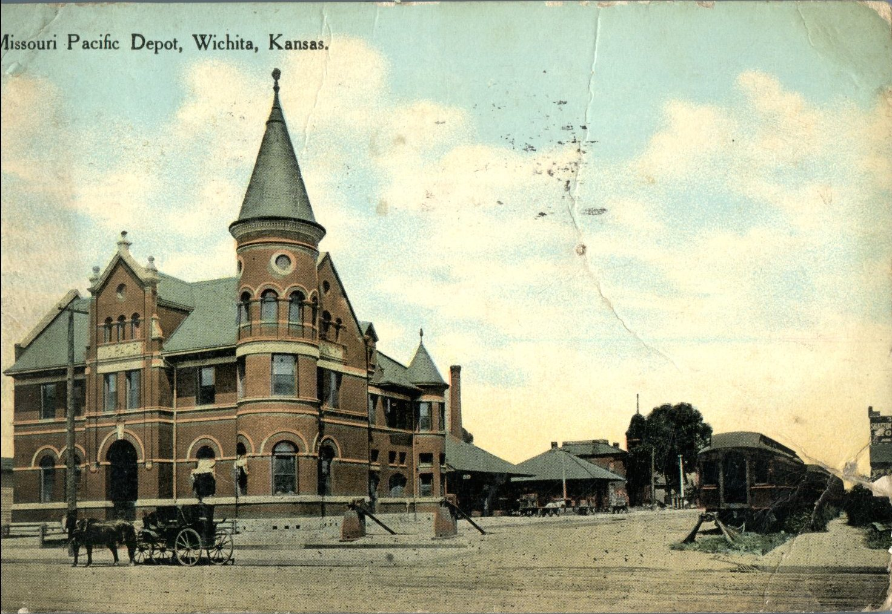
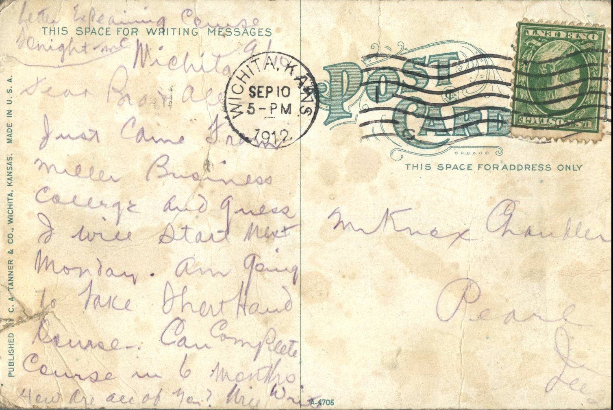

 From: Unknown, To: Knox Chandler Family  
Mailed From: Wichita, Kansas on September 10, 1912  
Postcard Info: Published by C.A. Tanner &amp; Co., Wichita Kansas. made in U.S.A.  
Picture Info: Missouri Pacific Depot, Wichita, Kansas

Mr. Knox Chandler  
Pearl, Illinois

Wichita 9/10  
Dear Bro &amp; all,  
Just came from Miller Business College and guess I will start next Monday. Am going to take short hand course. Can complete course in 6 months. How are ll of you? Write.  
Letter explaining course tonight.