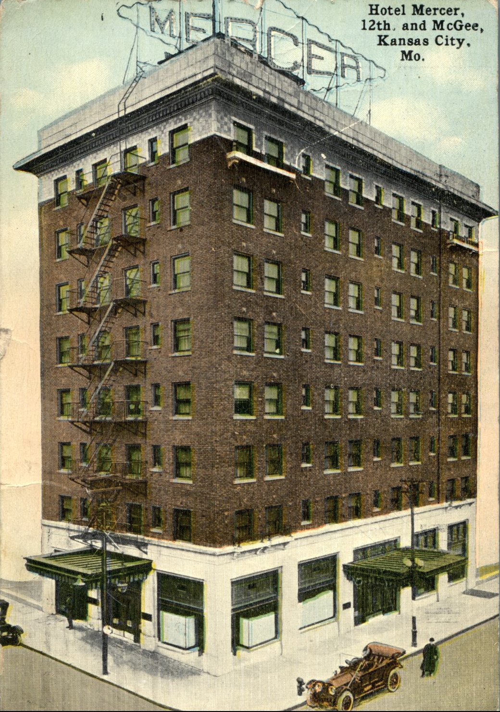
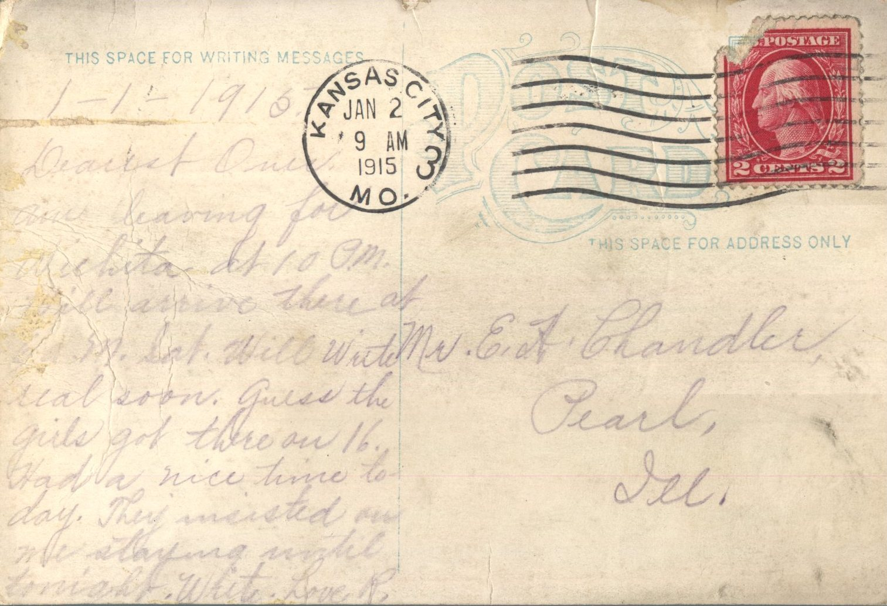

 From: Ruby Chandler, To: Elijah H. Chandler  
Mailed From: Kansas City, Mo. on January 2, 1915  
Picture Info: Hotel Mercer, 12th and McGee, Kansas City, Mo.

Mr. E.H. Chandler  
Pearl, Illinois

1-1-1915  
Dearest One,  
Am leaving for Wichita at 10 pm. Will arrive there at 6 am Saturday. Will write real soon. Guess the girls got there on 16. Had a nice time today. They insisted on me staying until tonight. Write.  
Love,  
R.