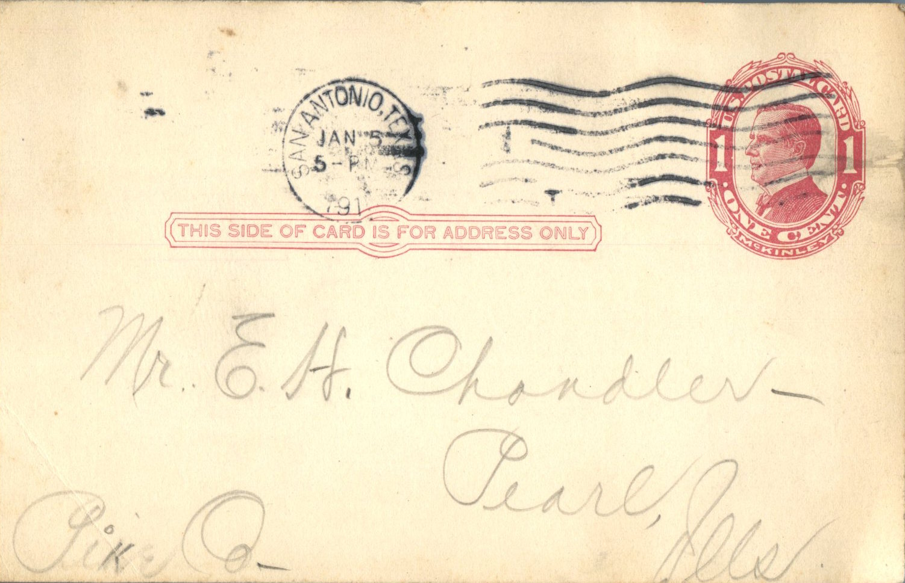
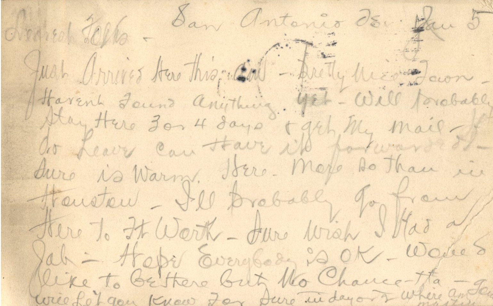

 

From: Martin Chandler, To: Elijah H. Chandler and Family  
Mailed From: San Antonio, Texas on January 5, 1915

Mr. E.H. Chandler  
Pearl, Ill  
Pike Co

San Antonio Tex Jan 5  
Dearest Folks,  
Just arrived here this am. Pretty nice town. Haven’t found anything yet. Will probably stay here 3 or 4 days and get my mail. If I do leave can have it forwarded . Sure is warm here. More so than in Houston. I’ll probably go from here to Ft. Worth. Sure wish I had a job. Hope everybody is OK. Would like to be there but no chance. Ha. Will let you know for sure in day or 2 where am going.  
Martin