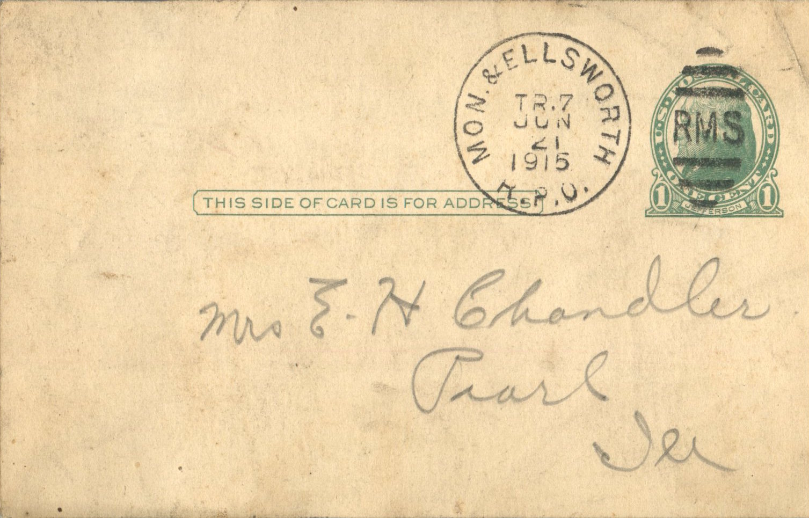
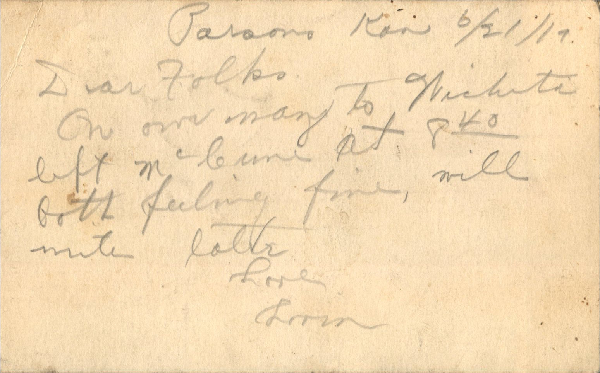

 

From: Lorin Chandler, To: Elijah H. Chandler and Family  
Mailed From: Patono, Kansas on June 21, 1919

Mrs. E.H. Chandler  
Pearl, Ill

Patono, Kan 6/21/19  
Dear Folks,  
On our way to Wichita. Left McLune at 8:40 both feeling fine, will write later.  
Love,  
Lorin