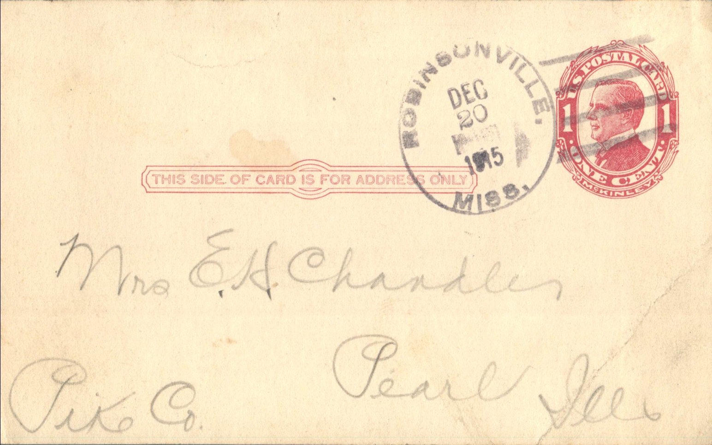
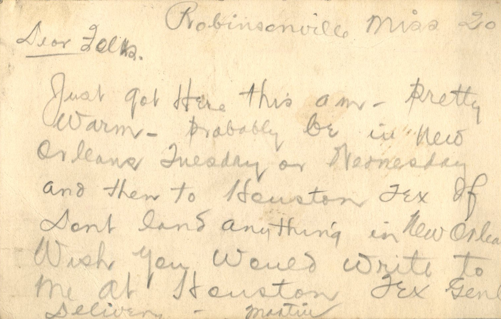

 

From: Martin Chandler, To: Elijah H. Chandler and Family  
Mailed From: Robinsonville, Mississippi on December 20, 1915

Mr. E.H. Chandler  
Pearl, Ill  
Pike Co

Robinsonville, Miss 20  
Dear Folks,  
Just for here this am. Pretty warm. Probably be in New Orleans Tuesday or Wednesday and then to Houston, Tex if don’t land anything in New Orleans. Wish you would write to me at Houston, Tex.  
-Martin