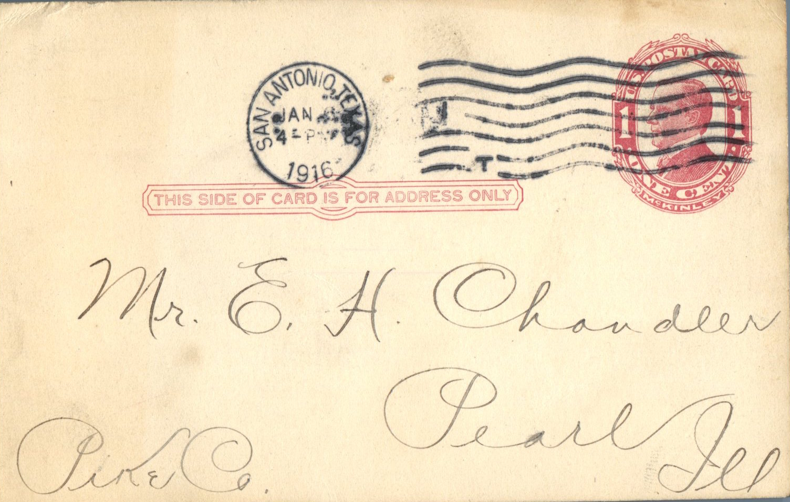
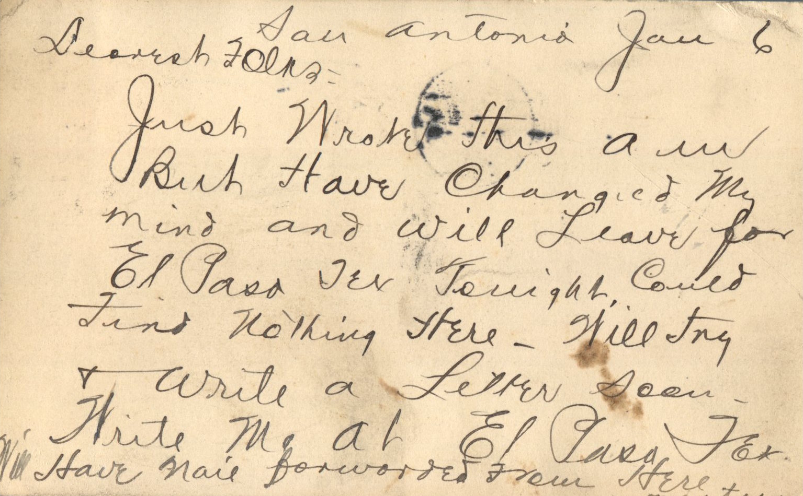

 

From: Martin Chandler, To: Elijah H. Chandler  
Mailed From: San Antonio, Texas on January 6, 1916

Mr. E.H. Chandler  
Pearl, Ill  
Pike Co

San Antonio, Jan 6  
Dearest Folks,  
Just wrote this am but have changed my mind and will leave for El Paso, TX tonight. Could find nothing here. Will try and write a letter soon. Write me at El Paso, Tex. Will have mail forwarded from here.  
Martin