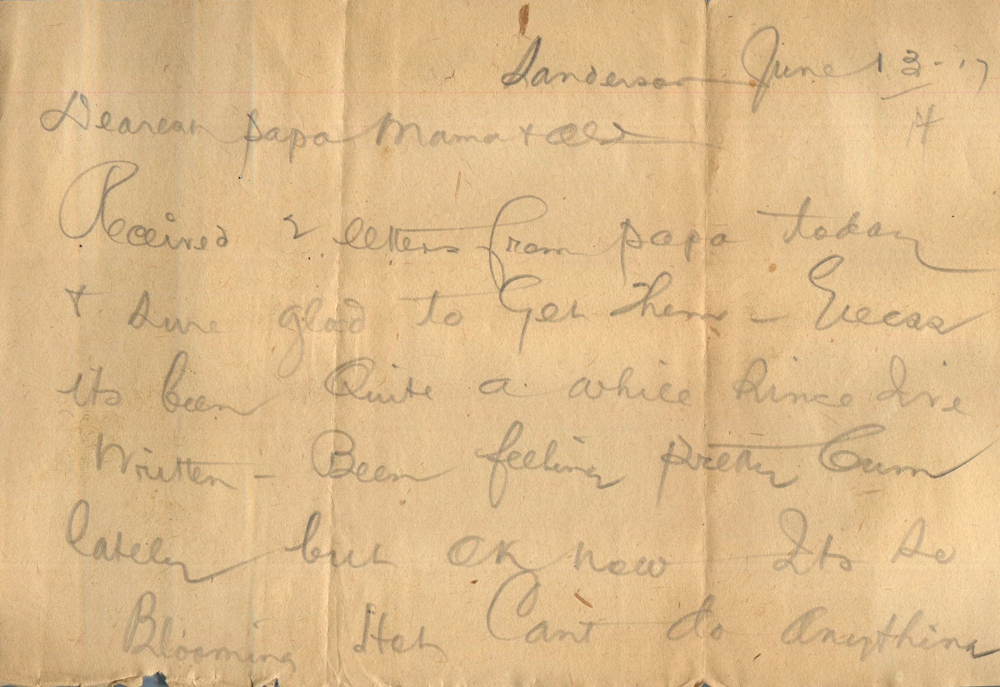
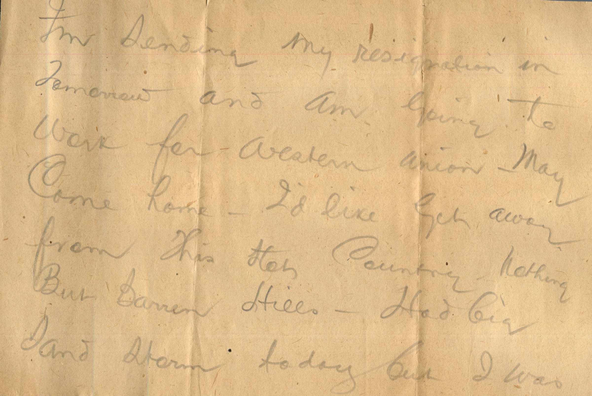
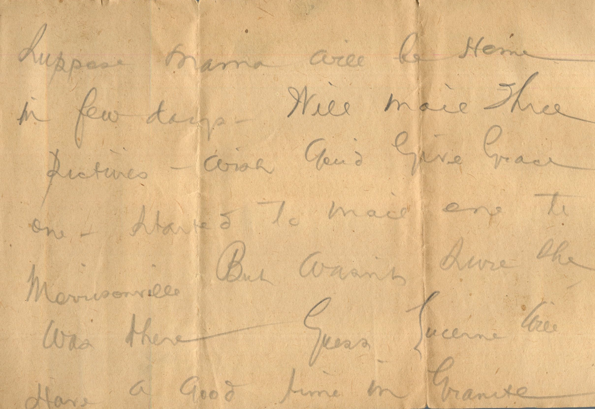
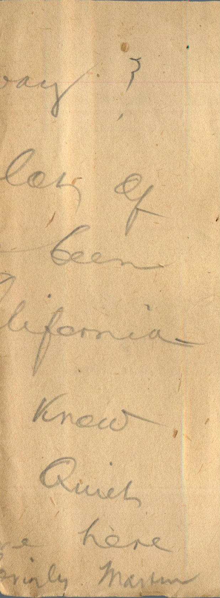
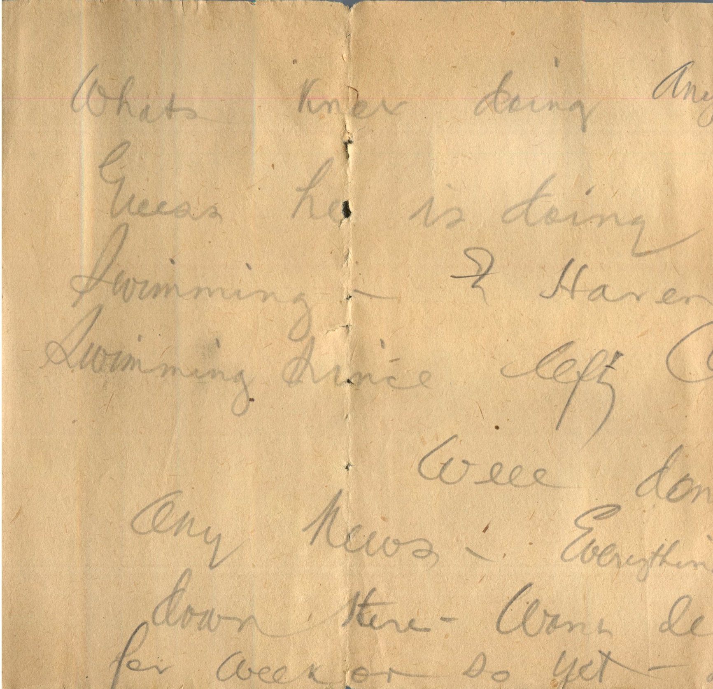

    

From: Martin Chandler, To: Elijah H. Chandler and Family  
Mailed From: Sanderson on June 14, 1917

Sanderson June 13-17  
Dearest Papa, Mama, and all  
Received 2 letters from papa today and sure glad to get them. Guess it’s been quite a while since I’ve written. Been feeling pretty glum lately but OK now. It’s blooming hot can’t do anything. I’m sending my resignation in tomorrow and am going to work for Western Union. May come home. I’d like to get away from this hot country, nothing but barren hills. Had big sand storm today but I was in bed and didn’t bother me any. Had my ears full of sand when I got up. Am sending you picture under separate cover. But you were all glad to see Bess, wish I could see you all. Suppose Mama will be home in a few days. Will mail three pictures. Wish you’d give Grace one. Started to mail one to Morrisonville but wasn’t sure she was there. Guess Lucerne will have a good time in Granite. Whats Knox doing anyway? Guess he is doing lots of swimming. I haven’t been swimming since left California.  
Well don’t know any news. Everything quiet down here. Wont leave here for week or so yet.  
Lovingly,  
Martin