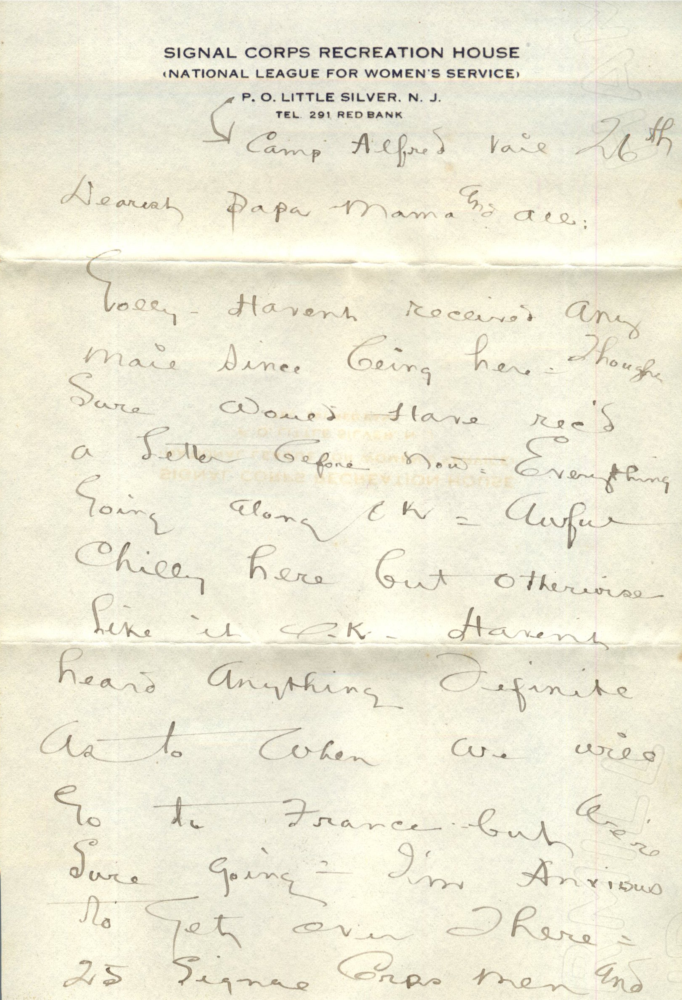
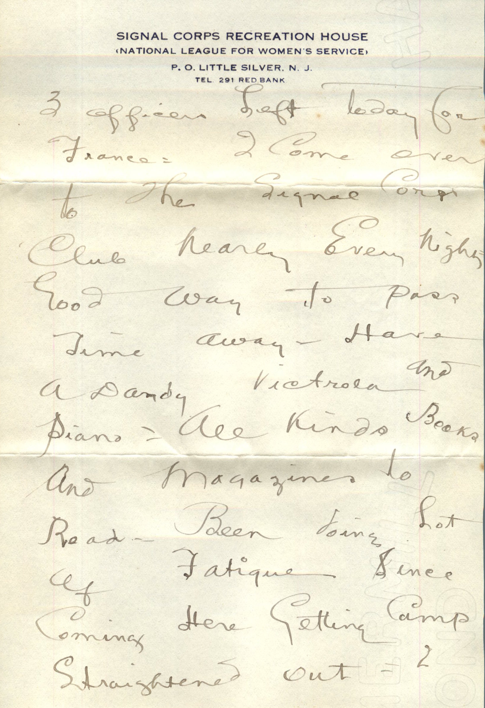
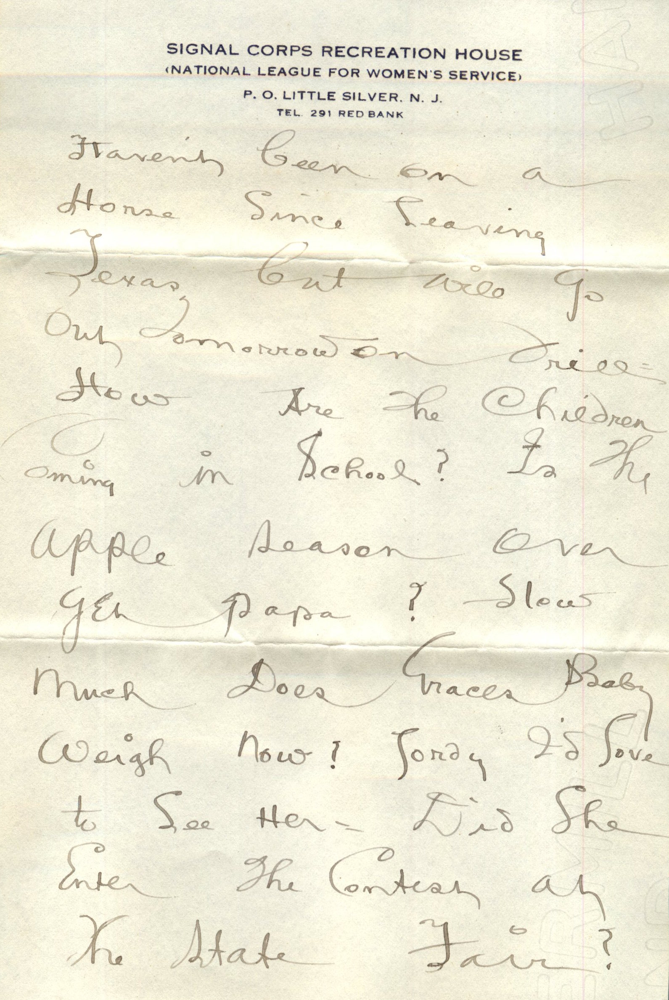
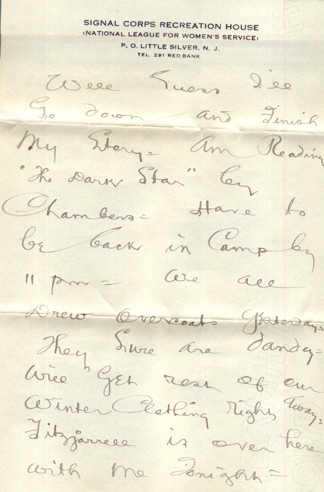
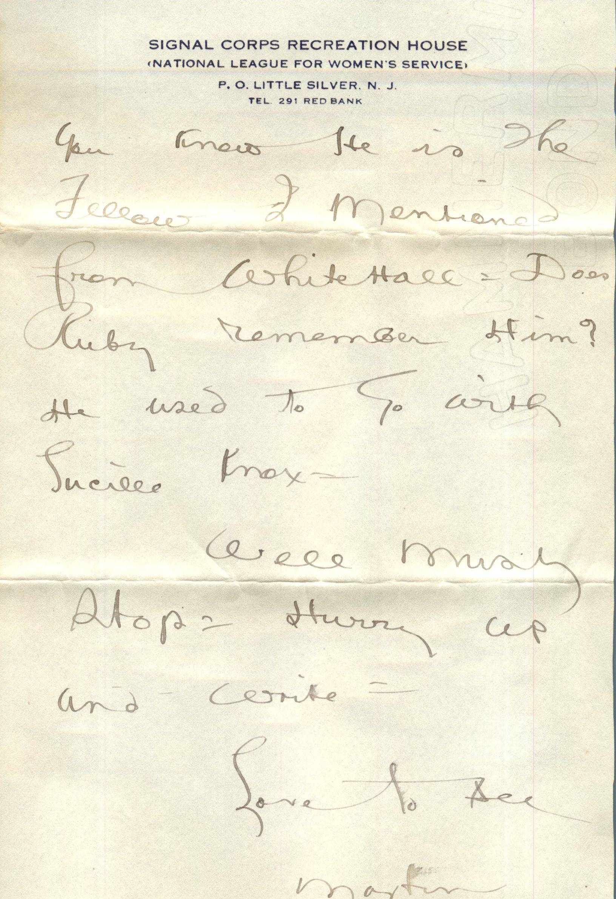
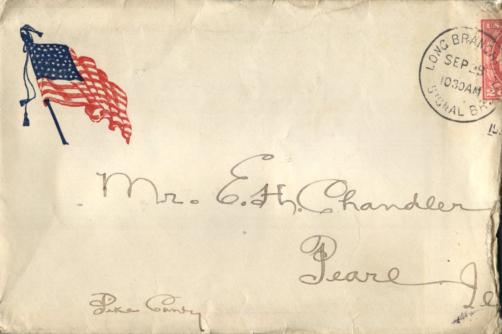
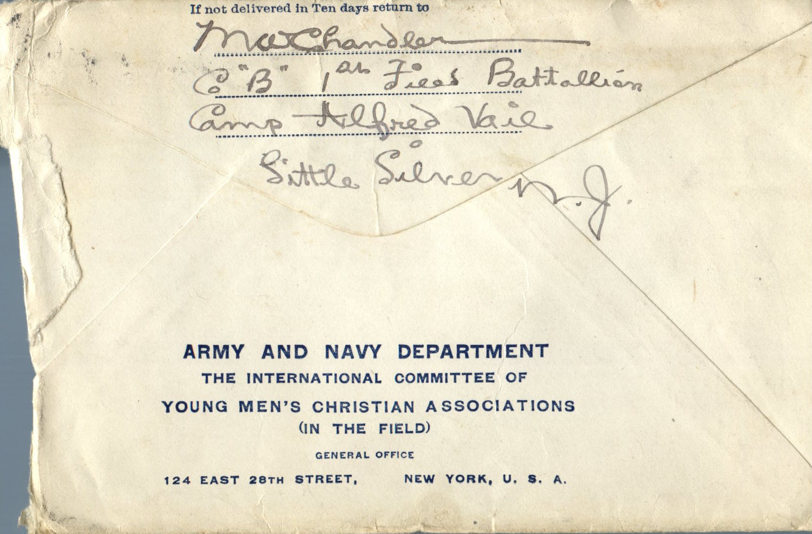

      

From: Martin Chandler, To: Elijah H. Chandler and Family  
Mailed From: Little Silver, New Jersey on September 28, 1917

M.W. Chandler  
Co “B” 1st Field Battalion  
Camp Alfred Vail  
Little Silver, N.J.

Mr. E.H. Chandler  
Pearl, Ill.  
Pike County

Camp Alfred, Vail 26th  
Dearest Papa, Mama, and all  
Golly Havent received any mail since being here. Thought sure would have received a letter before now. Everything going along OK. Awful chilly here but otherwise like it OK. Haven’t heard anything definite as to when we will go to France but were sure going. I’m anxious to get over there. 25 Signal Corps men and 3 officers left today for Franc. 2 come over to the Signal Corps Club nearly every night. Good way to pass time away. Have a dandy Victrola and piano. All kinds books and magazines to read. Been doing lot of fatigue since coming here getting camp straightened out. I haven’t been on a horse since leaving Texas but will go out tomorrow on drill. How are the children coming in school? Is the apple season over yet papa? How much does Grace’s baby weigh now? Lordy I’d love to see her. Did she enter the contest at the state fair? Well guess I’ll go down and finish my story. Am reading “The Dark Star” by Chambers. Have to be back in camp by 11 pm. We all drew overcoats yesterday. The sure are dandy. Will get rest of our winter clothing right away. Fitzjarrellz is over here with me tonight. You know he is the fellow I mentioned from White Hall. Does Ruby remember him? He used to go with Lucille Knox.  
Well must stop. Hurry up and write.  
Love to all,  
Martin