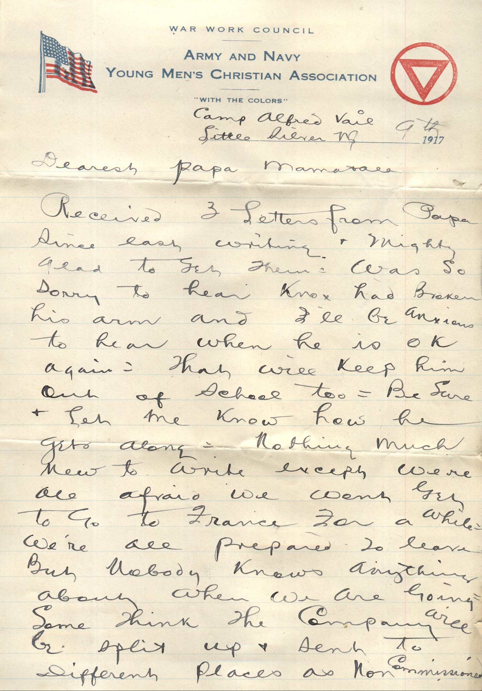
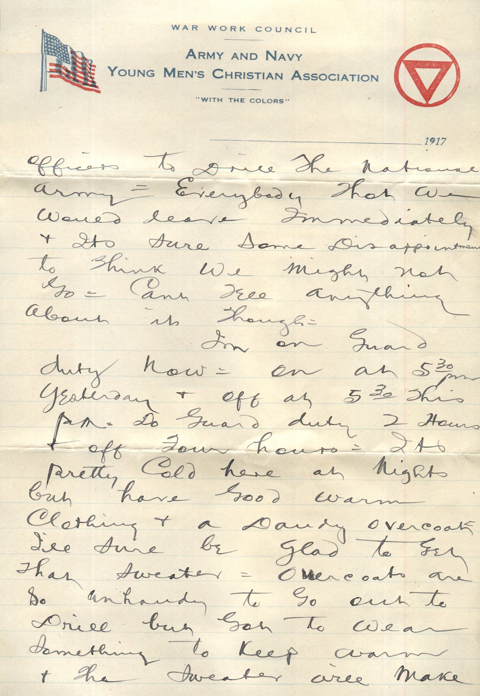
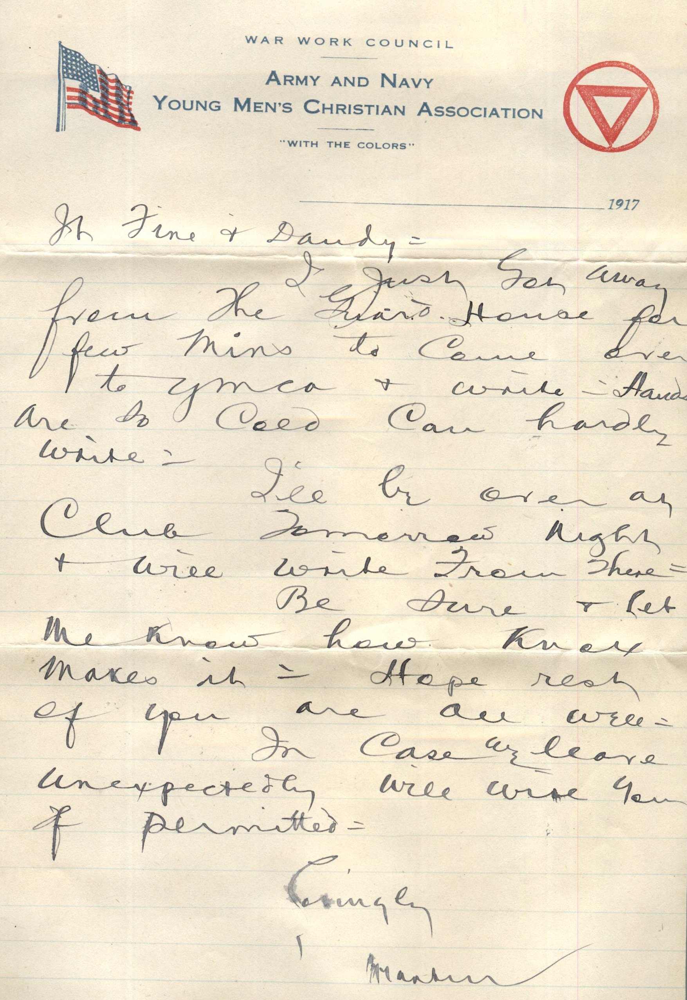
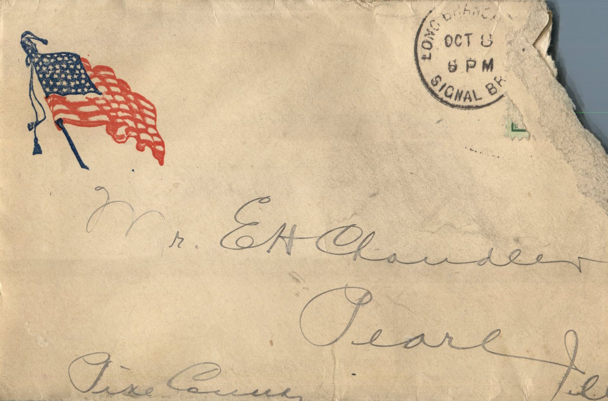
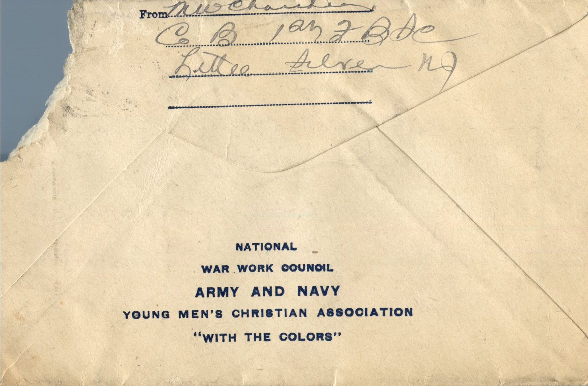

    

From: Martin Chandler, To: Elijah H. Chandler and Family  
Mailed From: Camp Alfred Vail, Litte Silver, New Jersey on October 8, 1917

Mr. E.H. Chandler  
Pearl, Ill  
Pike County

M.W. Chandler  
Co B 1st FBSC  
Little Silver, NJ

Camp Alfred Vail  
Little Silver, NJ 9th 1917  
Dearest Papa, Mama, and all  
Received 3 letters from papa since last writing and mighty glad to get them. Was so sorry to hear Knox has broken his arm and I’ll be anxious to hear when he is OK again. That will keep him out of school too. Be sure and let me know how he gets along. Nothing much new to write except were all afraid we wont get to go to France for awhile. We’re all prepared to leave but nobody know anything about when we are going. Some think the company will be split up and sent to different places as non commissioned officers to drill the National army. Everybody thought we would leave immediately and its sure some disappointment to think we might not go. Can’t tell anything about it though.  
I’m on guard duty now. On at 5:30 pm yesterday and off at 5:30 this pm. Do guard duty 2 hours off four hours. It’s pretty cold here at nights but have good warm clothing and a dandy overcoat. I’ll sure be glad to get that sweater. Overcoats are so unhandy to go out to drill but got to wear something to keep warm and that sweater will make it fine and dandy.  
I just got away from the guard house for few mins to come over to YMCA and write. Hands are so cold can hardly write.  
I’ll be over at club tomorrow night and will write from there.  
Be sure and let me know how Knox makes it. Hope rest of you are all well.  
In case we leave unexpectedly will write you if permitted.  
Lovingly,  
Martin