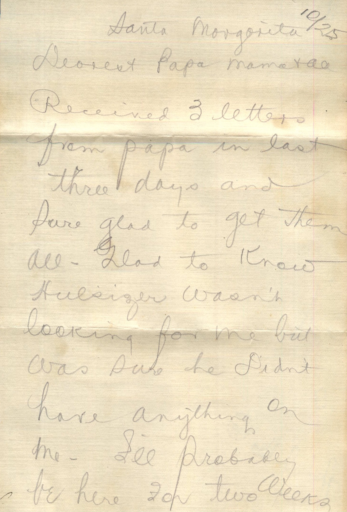
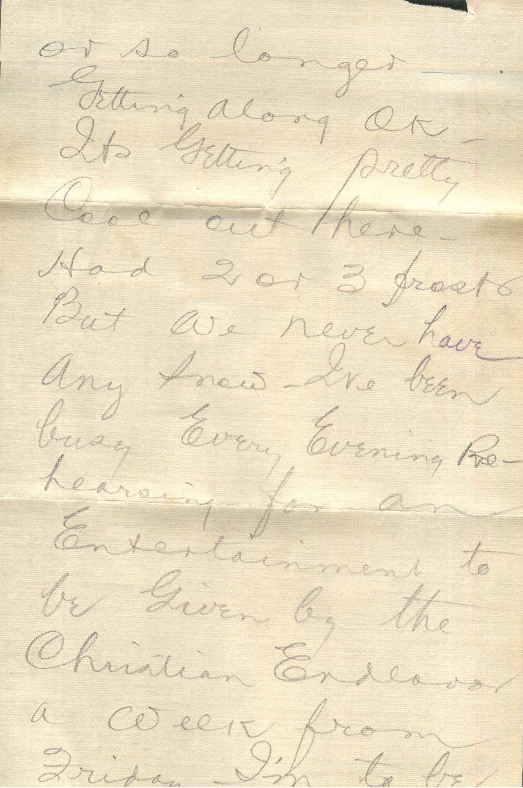
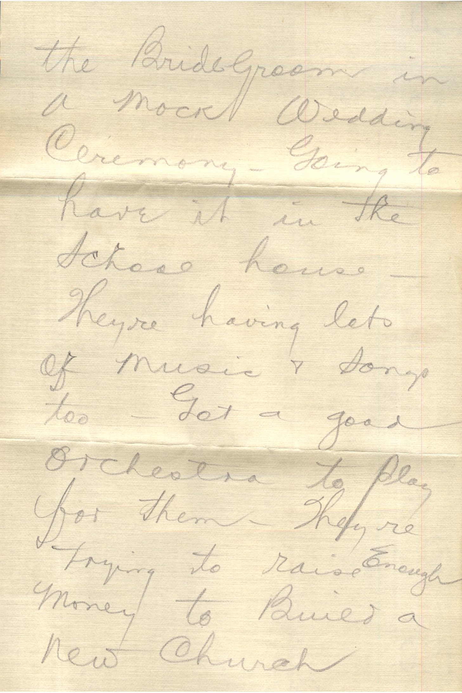
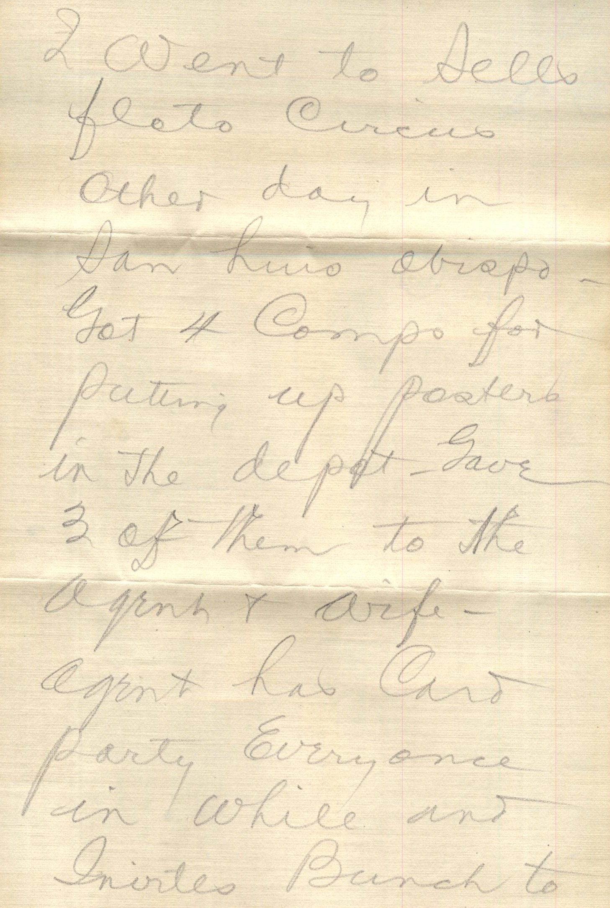
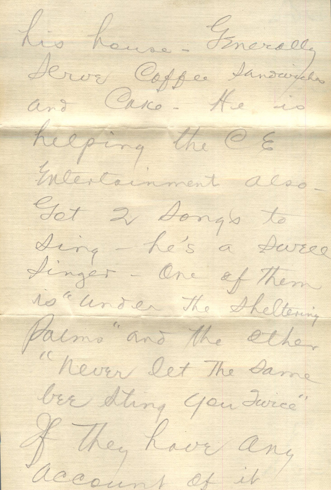
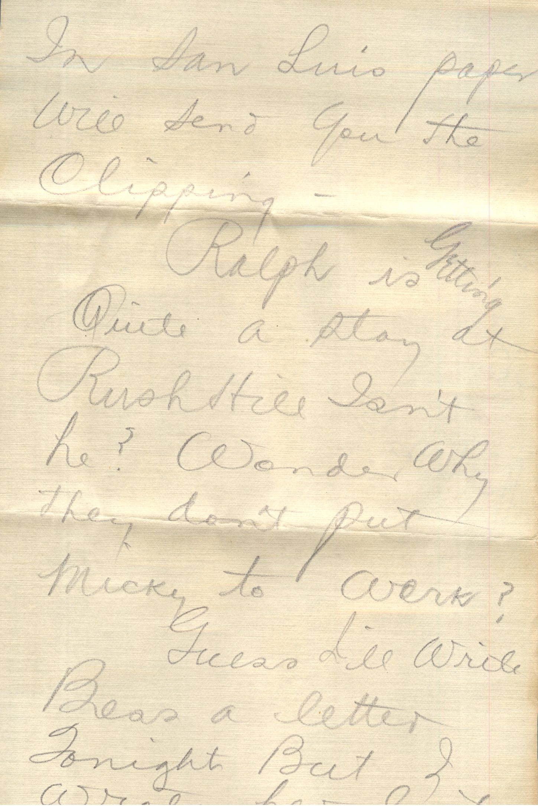
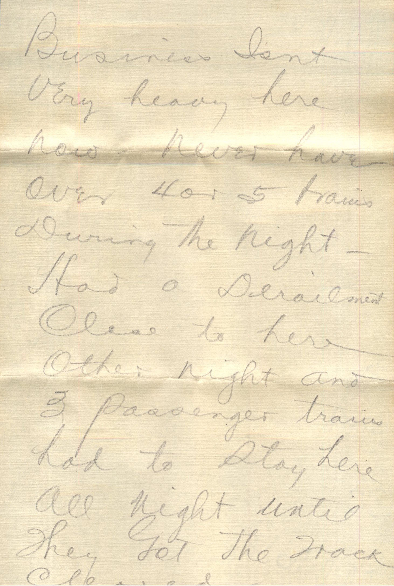
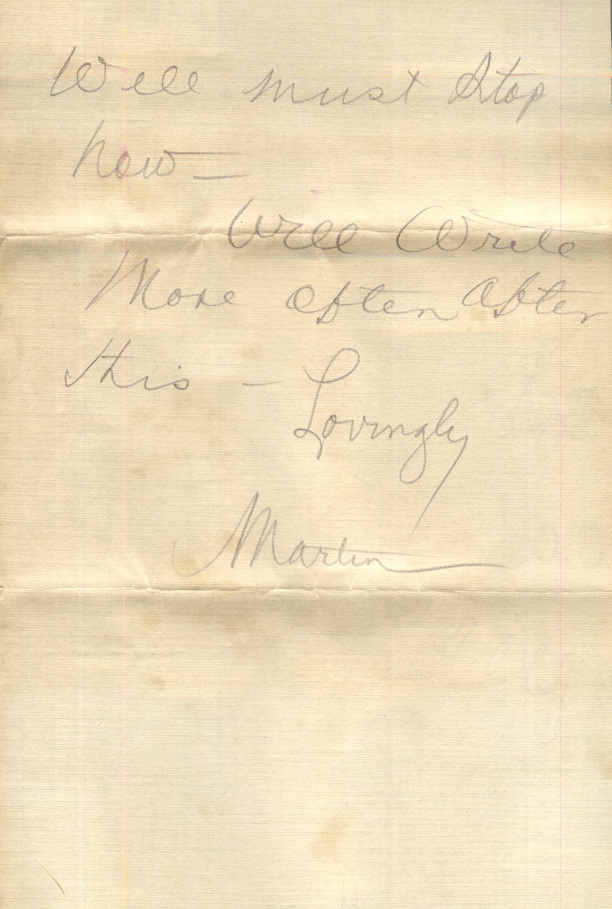

       

From: Martin Chandler, To: Elijah H. Chandler  
Mailed From: Santa Margarita, CA on October 25, 1917

Mr. E.H. Chandler  
Pearl, Illinois  
Pike County

Santa Margarita 10/25  
Dearest Papa, Mama, and all  
Received 3 letters from papa in last three days and sure glad to get them. Glad to know Hulsingler wasn’t looking for me but was sure he didn’t have anything on me. I’ll probably be here for two weeks or so longer. Getting along OK. It’s getting pretty cool out here. Had 2 or 3 frosts but we never have any snow. I’ve been busy every evening rehearsing of an entertainment to be given by the Christian Endeavor a week from Friday. I’m to be the bridegroom in a mock wedding ceremony. Going to have it in the school house. They’re having lots of music and songs too. Got a good orchestra to play for them. They’re trying to raise enough money to build a new church. I went to Sell’s first circus other day in San Luis abispo. Got 4 comps for putting up posters in the depot. Gave 3 of them to the agent and wife, agent has card party every once in while and invites bunch to his house. Generally serve coffee, sandwiches, and cake. He is helping the CE entertainment also. Got 2 songs to sing – He is a swell singer- One of them is “Under the Sheltering Palms” and the other “Never Let the Same Bee Sting you Twice.” If they have any account of it in San Luis paper will send you the clipping.  
Ralph is getting quite a stay at Rush Hill isn’t he? Wonder why they don’t put Micky to work.  
Guess I’ll write Bess a letter tonight but I wrote her last. Business isn’t very heavy here now. Never have over 4 or 5 trains during the night. Had a derailment close to here other night and 3 passenger trains had to stay here all night until they got the track cleared. Well must stop now.  
Will write more often after this.  
Lovingly,  
Martin