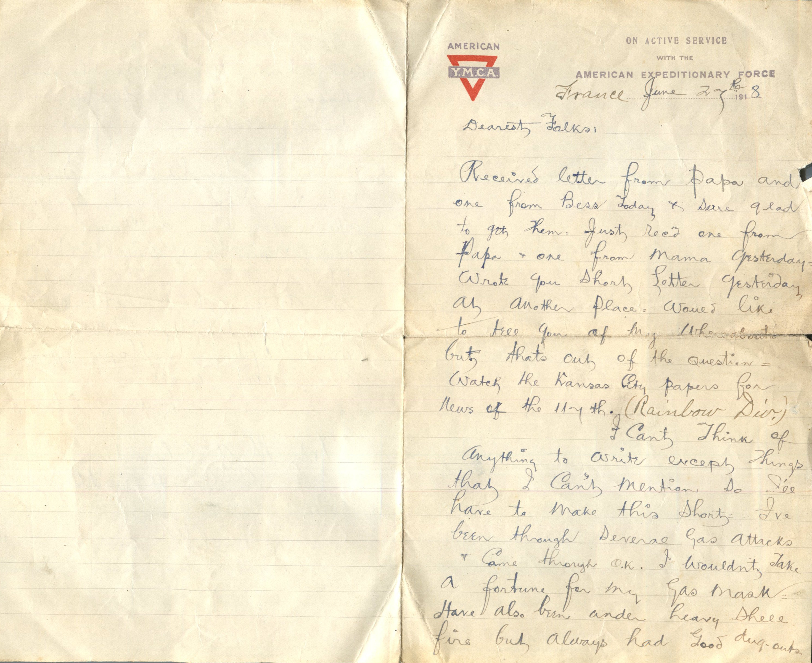
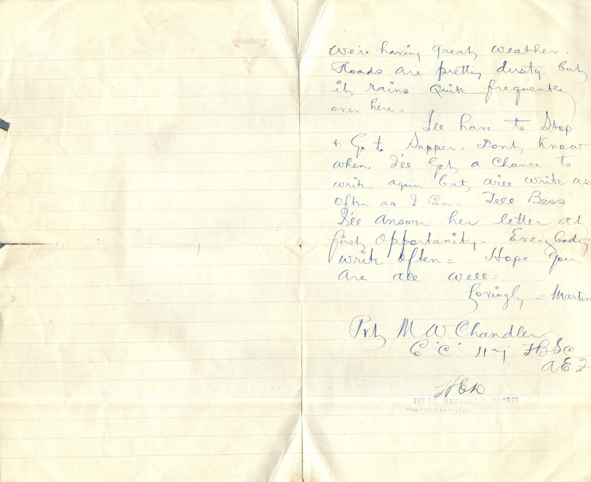

 

From: Martin Chandler, To: Elijah H. Chandler and Family  
Mailed From: France on June 27, 1918

France June 27th, 1918  
Dearest Folks,  
Received letter from Papa and one from Bess today and sure glad to get them. Just received one from Papa and one from Mama yesterday. Wrote you short letter yesterday at another place. Would like to tell you of my whereabouts but thats out of the question. Watch the Kansas City papers for news of the 117th (Rainbow Div.).  
I can’t think of anything to write except things that I can’t mention so I’ll have to make this short. I’ve been through several gas attacks and come through OK. I wouldn’t take a fortune for my gas mask. Have also been under heavy shell fire but always had good dug outs.  
We’re having great weather. Roads are pretty dusty but it rains quite frequent over here.  
I’ll have to stop and go to supper. Don’t know when I’ll get a chance to write again but will write as often as I can. Tell Bess I’ll answer her letter at first opportunity. Everybody write often. Hope you are all well.  
Lovingly,  
Martin

Pvt. M.W. Chandler  
Co “C” 117 FBSC  
AEF