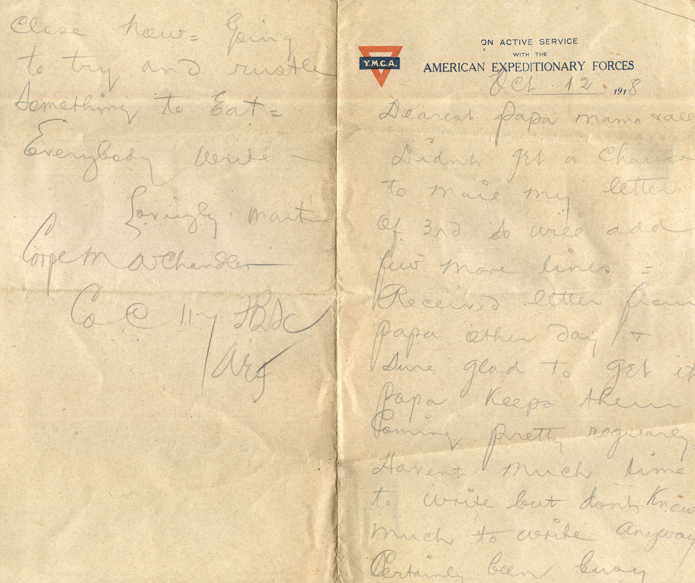
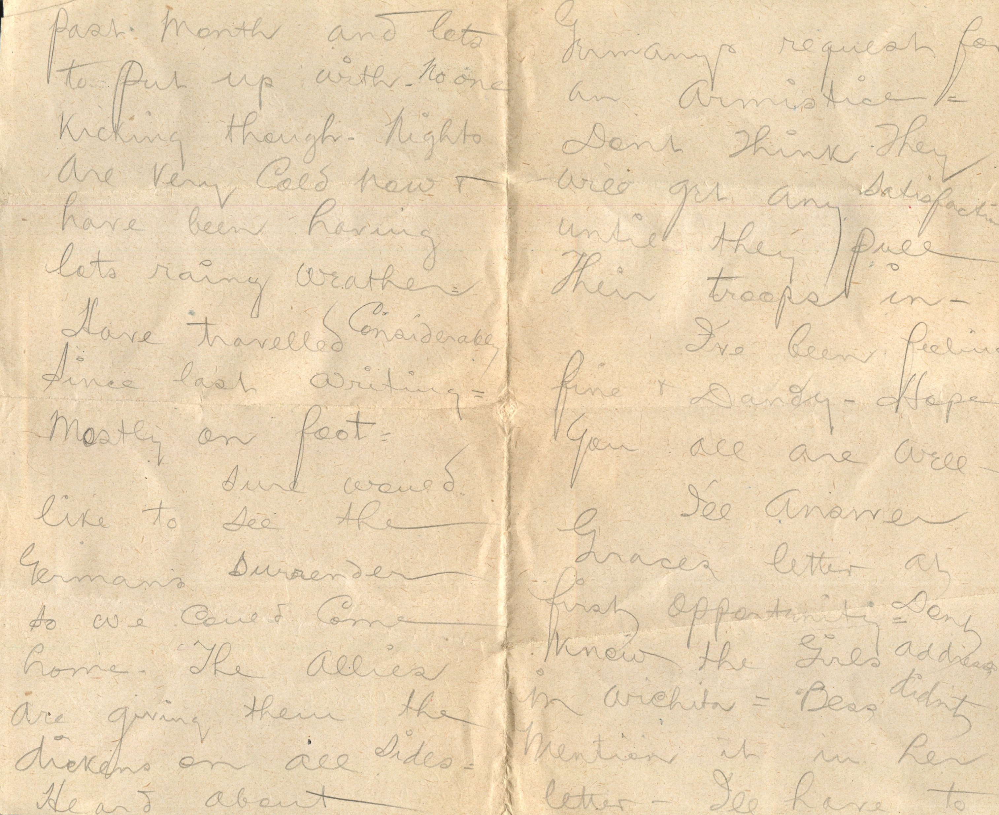

 

From: Martim Chandler, To: Elijah H. Chandler and Family  
Mailed On: October 12, 1918

Oct. 12 1918  
Dearest Papa, Mama, and all,  
Didn’t geta chance to mail my letter of 3rd so will add few more lines. Received letter from papa other day and sure glad to get it. Papa keeps them coming pretty regularly. Haven’t much time to write but don’t know much to write anyway. Certainly been busy past month and lots to put up with. No one kicking through, nights are very cold now and have been having lots of rainy weather. Have travelled considerably since last writing. Mostly on foot.  
Sure would like to see the Germans surrender so we could come home. The allies are giving them the dickens on all sides. Heard about German’s request for an armistice. Don’t think they will get any satisfaction until they pull their troops in.  
I’ve been feeling fine and dandy. Hope you all are well.  
I’ll answer Grace’s letter at first opportunity. Don’t know the girl’s address in Wichita. Bess didn’t mention it in her letter. I’ll have to close now. Going to try and rustle something to eat. Everybody write.  
Lovingly,  
Martin