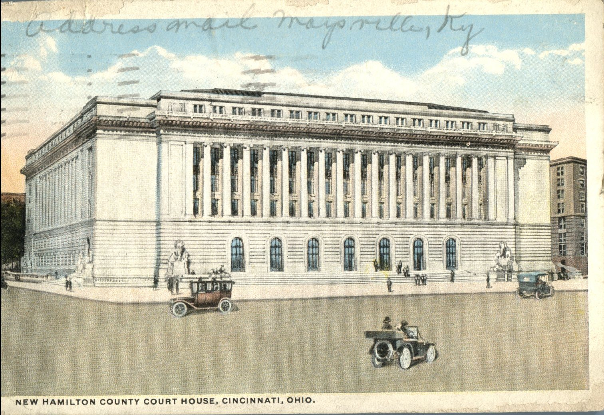
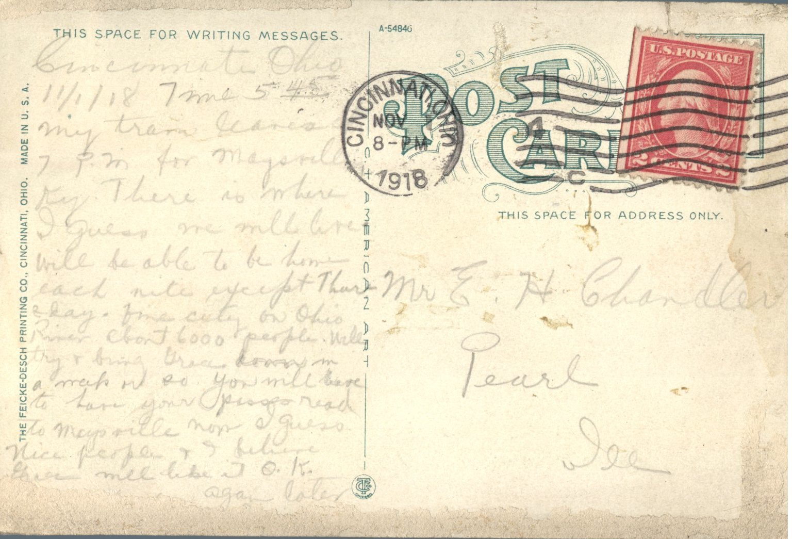

 

From: Unknown, To: Elijah H. Chandler  
Mailed From: Cincinnati, Ohio on November 8, 1918

Mr. E.H. Chandler  
Pearl, Illinois

Cincinnati, Ohio  
11/1/18, Time: 5:45  
My train leaves 7 pm for Magsully. There is where I guess we will meet. Will be able to be home each night except Thursday. Fine traveling on Ohio River, 6000 purple. Will try and bring Grace a map or so you will have to have your Bess read to Maysville. I guess nice people and I believe there all like me O.K.  
Again later