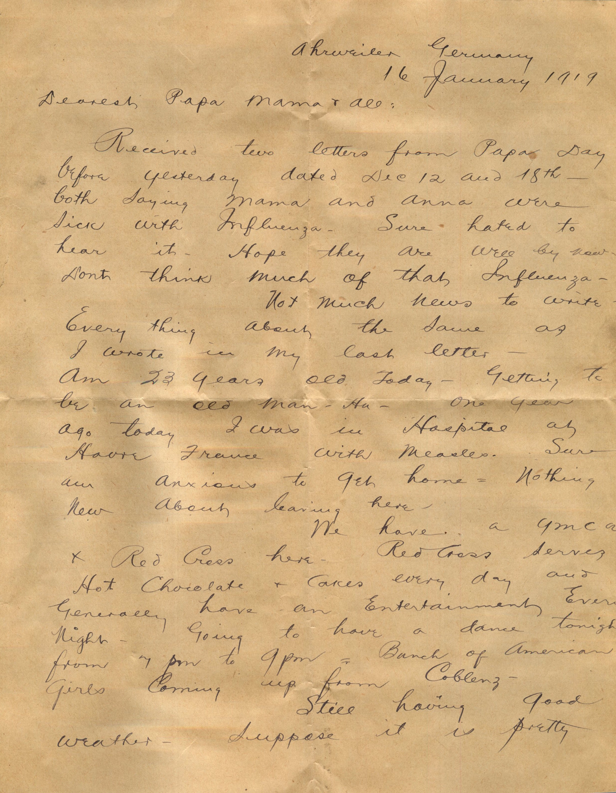
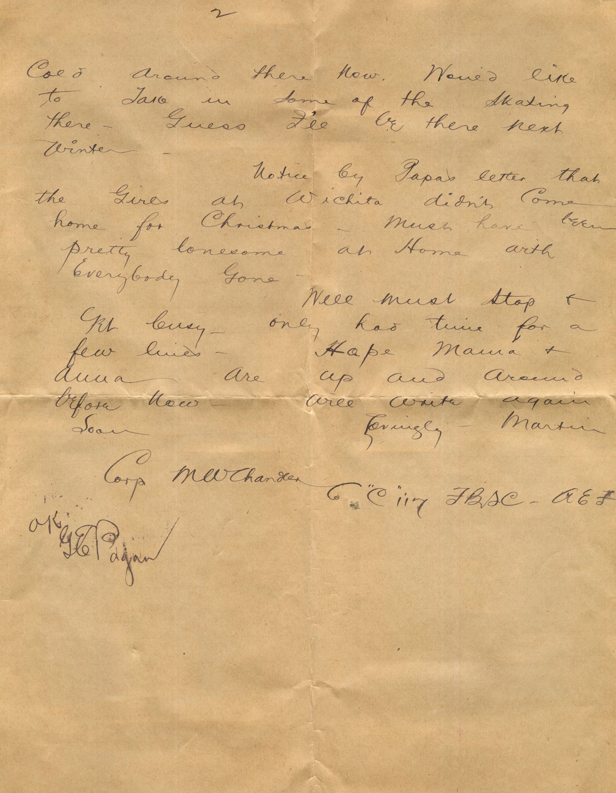
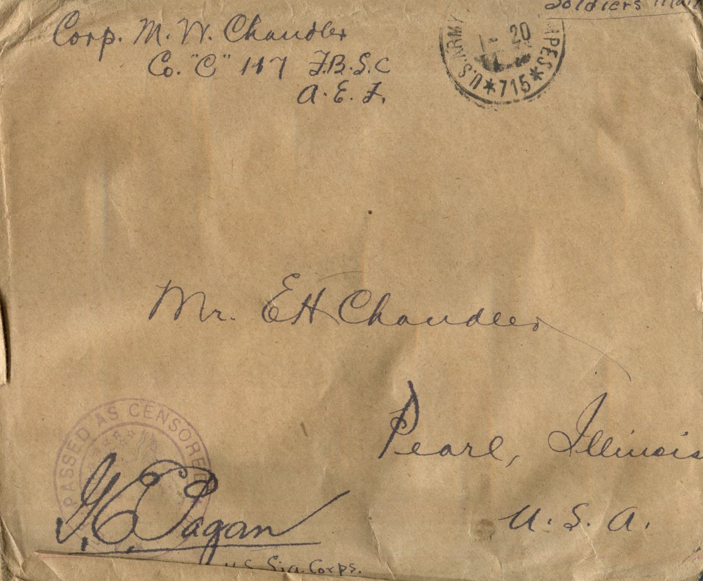

  

From: Martin Chandler, To: Elijah H. Chandler and Family  
Mailed From: Ahrweiler, Germany on January 16, 1919

Corp. M.W. Chandler  
Co “C” 117 F.B.S.C.  
A.E.F.

Mr. E.H. Chandler  
Pearl, Illinois  
USA

Ahrweiler, Germany  
16 January 1919  
Dearest Papa, Mama, and all  
Received two letters from Papa day before yesterday dated Dec 12 and 18th both saying Mama and Anna were sick with influenza. Sure hated to hear it. Hope they are well by now. Don’t think much of that influenza.  
Not much news to write. Every thing about the same as I wrote in my last letter. Am 23 years old today. Getting to be an old man -Ha. One year ago today I was in hospital at Havre, France with measles. Sure am anxious to get home. Nothing new about leaving here.  
We have a YMCA and Red Cross here. Red Cross serves hot chocolate and cake every day and generally have an entertainment every night. Going to have a dance tonight from 7 pm to 9 pm. Bunch of American girls coming up from Coblenz.  
Still having good weather. Suppose it is pretty cold around there now. Would like to take in some of the skating there. Guess I’ll be there next winter.  
Notice by Papa’s letter that the girls at Wichita didn’t come home for Christmas. Must have been pretty lonesome at home with everybody gone.  
Well must stop and get busy. Only had time for a few lines. Hope Mama and Anna are up and around before now. Will write again soon.  
Lovingly,  
Martin

Corp. M.W. Chandler  
C “C” 117 FBSC  
A.E.F.