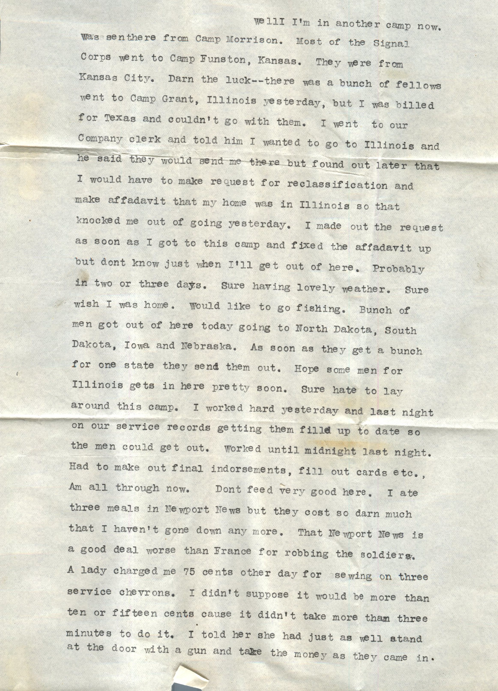
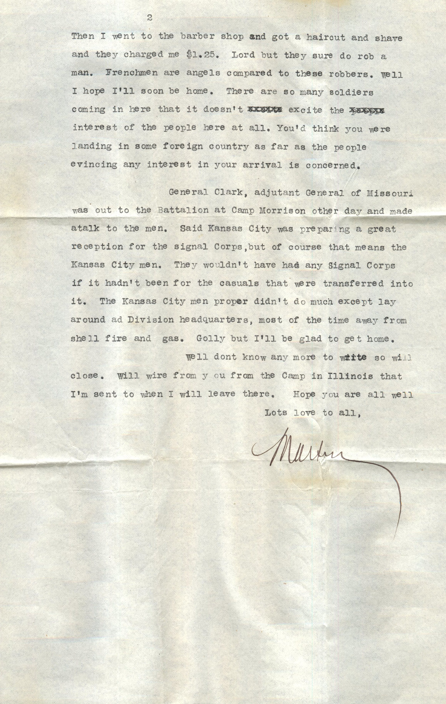
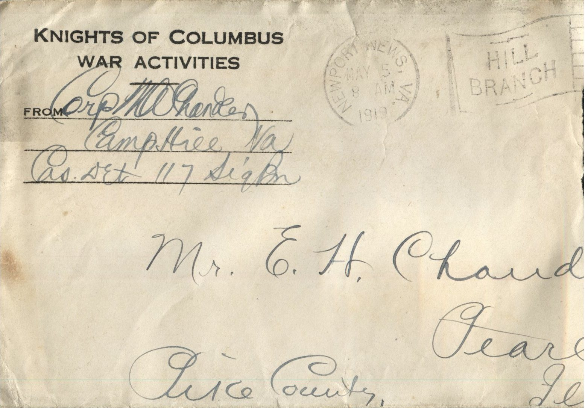

  

From: Martin Chandler, To: Elijah H. Chandler  
Mailed From: Camp Hill, Virginia on May 3rd, 1919

Corp M.W. Chandler  
Camp Hill, Va.  
Cas. Set 117 Sig Br.

Mr. E.H. Chandler  
Pearl, Illinois  
Pike County

Camp Hill, Va., May 3rd, 1919  
Dearest Papa, Mama, and all,  
Well I’m in another camp now. Was sent there from Camp Morrison. Most of the Signal Corps went to Camp Funston, Kansas. They were from Kansas City. Darn the luck–there was a bunch of fellows went to Camp Grant, Illinois yesterday, but I was billed for Texas and couldn’t go with them. I went to our Company clerk and told him I wanted to go to Illinois and he said they would send me there but found out later that I would have to make request for reclassification and make affidavit that my home was in Illinois so that knocked me out of going yesterday. I made out the request as soon as I got to this camp and fixed the affidavit up but don’t know just when I’ll get out of here. Probably in two or three days. Sure having lovely weather. Sure wish I was home. Would like to go finishing. Bunch of men got out of here today going to North Dakota, South Dakota, Iowa, and Nebraska. As soon as they get a bunch for one state they send them out. Hope some men for Illinois gets in here soon. Sure hate to lay around this camp. I worked hard yesterday and last night on our service records getting them filled up to date so the men could get out. Worked until midnight last night. Had to make out final endorsements, fill out cards etc., am all through now. Don’t feed very good here. I ate three meals in Newport News but they cost so darn much that I haven’t gone down any more. That Newport News is a good deal worse than France for robbing the soldiers. A lady charged me 75 cents other day for sewing on three service chevrons. I didn’t suppose it would be more than ten or fifteen cents cause it didn’t take more than three minutes to do it. I told her she had just as well stand at the door with a gun and take the money as they came in. Then I went to the barber shop and got a haircut and shave and they charged me $1.25. Lord but they sure do rob a man. Frenchmen are angels compared to these robbers. Well I hope I’ll soon be home. There are so many soldiers coming in here that it doesn’t excite the interest of the people here at all. You’d think you were landing in some foreign country as far as the people evincing any interest in your arrival is concerned.  
General Clark, adjutant General of Missouri was out to the Battalion at Camp Morrison other day and made a talk to the men. Said Kansas City was preparing a great reception for the signal corps, but of course that means the Kansas City men. They wouldn’t have had any signal Corps if it hadnt been for the causals that were transferred into it. The Kansas City men proper didnt do much excel lay around at Division headquarters, most of the time away from shell fire and gas. Golly but I’ll be glad to get home.  
Well don’t know any more to write so will close. Will wire from ou from the camp in Illinois that I’m sent to when I will leave there. Hope you are all well  
Lots love to all,  
Martin