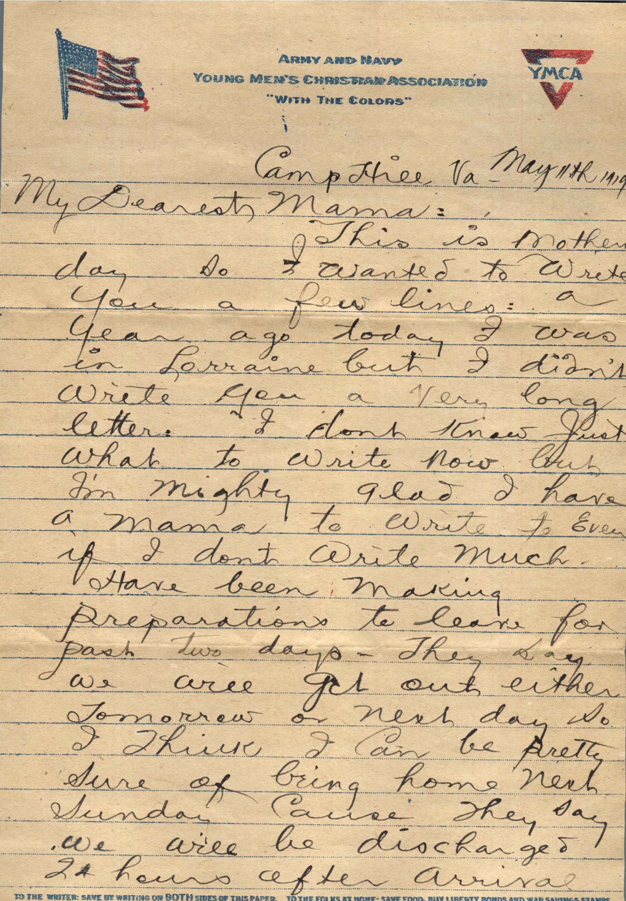
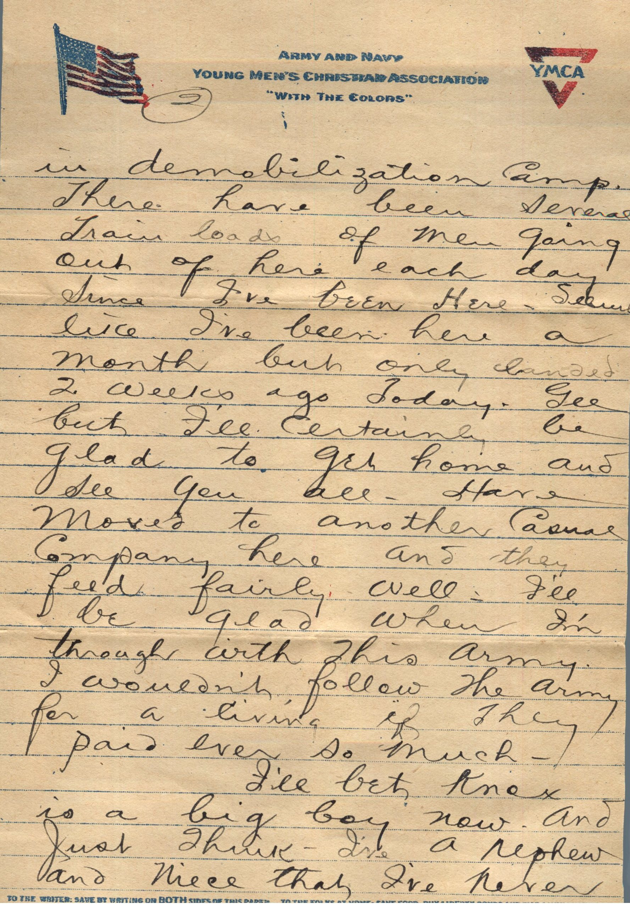
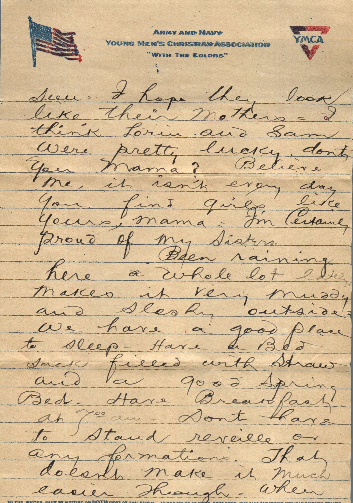
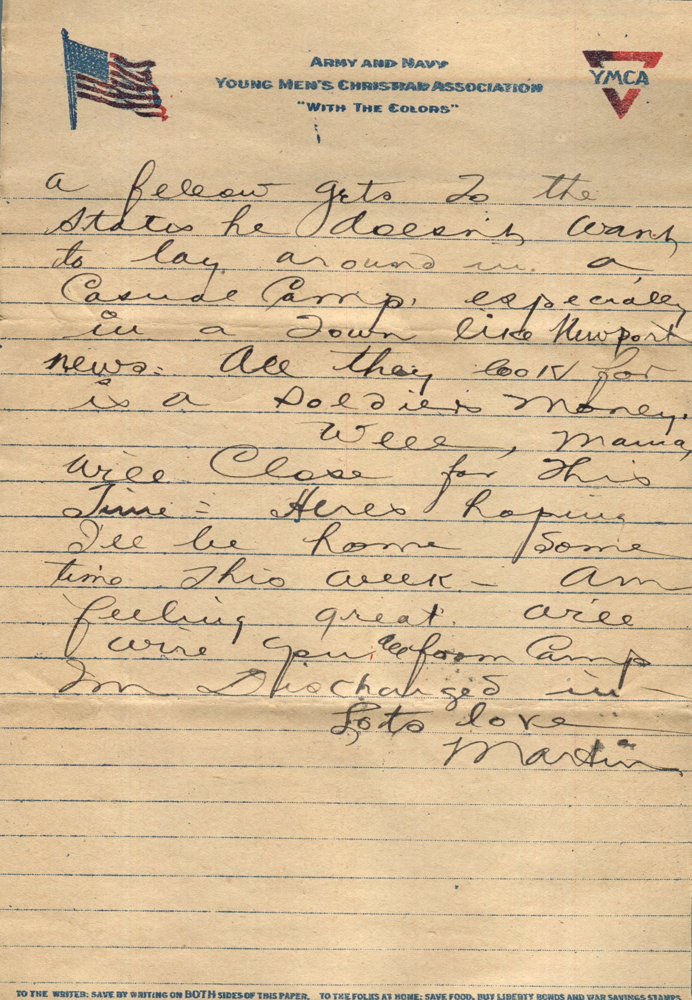
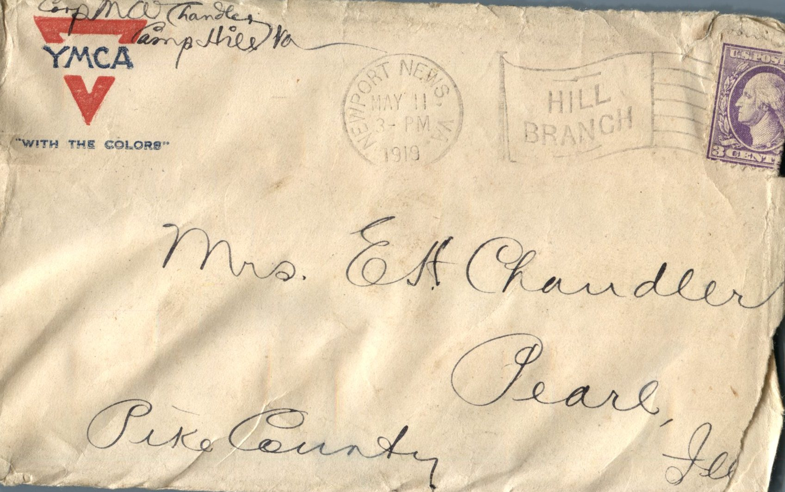

      
From: Martin Chandler, To: Jeanette Knox Chandler  
Mailed On: May 11, 1919 from Newport News, Va.  
Mrs. E.H. Chandler  
Pike County  
Pearl, Ill.

Chandler  
Camp Hill, Va.

Camp Hill, Va.  
May 11, 1919  
My Dearest Mama,  
This is Mother’s day so I wanted to write you a few lines: a year ago today I was in Lorraine but I didn’t write you a very long letter. I don’t know just what to write now but I’m mighty glad to have a Mama to write to even if I don’t write much.  
Have been making preparations to leave for past two days. They say we will get out either tomorrow or next day so I think I can be pretty sure of being home next Sunday cause they say we will be discharged 2 hours after arrival in demobilization camp. There have been several train loads of men going out of here each day since I’ve been here. Seems like I’ve been here a month but only landed 2 weeks ago today. Gee but I’ll certainly be glad to get home and see you all. Have moved to another casual company here and they feed fairly well. I’ll be glad when I’m through with this army. I wouldn’t follow the army for a living if they paid ever so much.  
I’ll bet Knox is a big boy now. And just think-I’ve a nephew and niece that I’ve never seen. I hope they look like their mother. I think Lorin and Sam were pretty lucky, don’t you Mama? Believe me, it isn’t everyday you find girls like yours mama. I’m certainly proud of my sisters.  
Been raining here a whole lot lately. Makes it very muddy and slushy outside. We have a good place to sleep. Have a bed sack filled with straw and a good spring bed. Have breakfast at 7 am. Don’t have to stand reveille or any formations. That doesn’t make it much easier though. When a fellow gets to the states he doesn’t want to lay around in a Casual Camp especially in a town like Newport News. All they look for is a soldier’s money.  
Well, Mama, will close for this time. Here’s hoping I’ll be home sometime this week. Am feeling great will wire you all from camp I’m discharged in.  
Lots Love,  
Martin