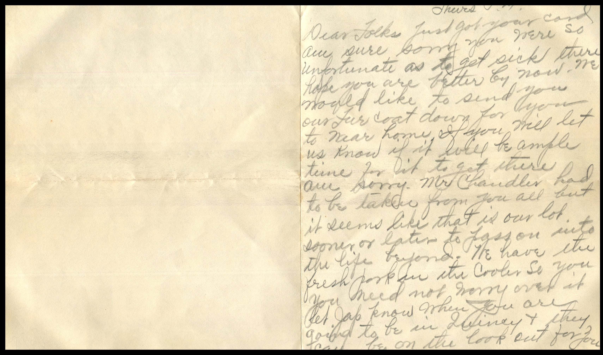
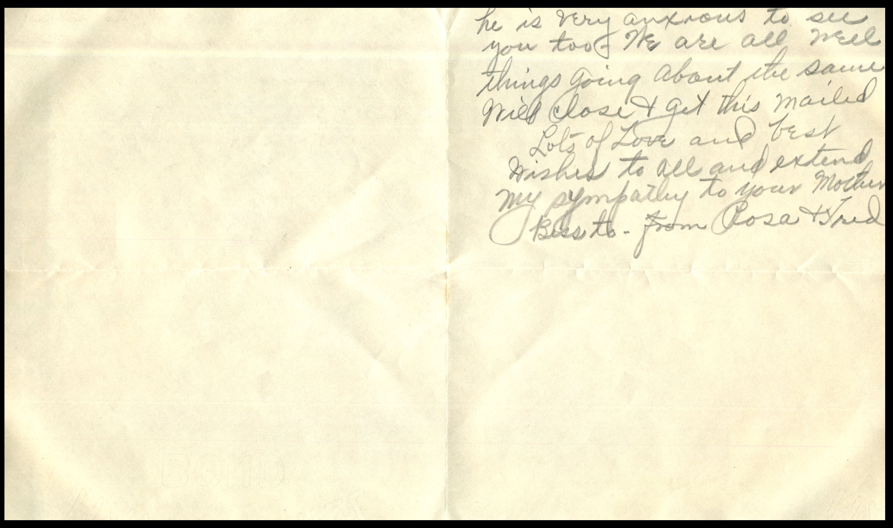
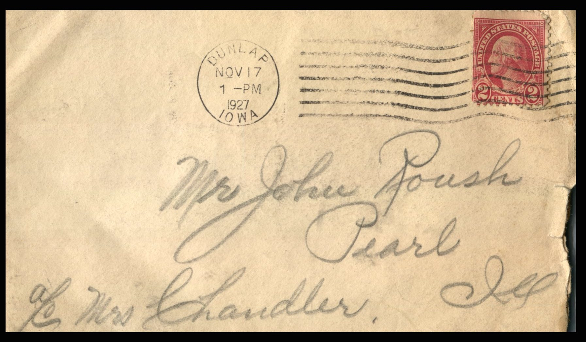

  From: Rosa and Fred, To: John Roush  
Mailed From: Dunlap, Iowa on November 17, 1927

Mr. John Roush  
Pearl, Ill  
c/o Mrs. Chandler

Thursday P.M.  
Dear Folks,  
Just got your card. Are sure sorry you were so unfortunate as to get sick there. Hope you are better by now. We would elite to send you our fur coat down for you to wear home. If you will let us low if it will be ample time for it to get there. Am sorry Mr. Chandler had to be taken from you all but it seems like that is our lot – sooner or later to pass on into the life beyond. We have the fresh pork in the cooler so you need not worry over it. Let Jap know when you are going to be in Quincy and they can be on the lookout for you. He is very anxious to see you too. We are all well. Things going about the same. Will close &amp; get this mailed.  
Lots of love and best wishes to all and extend my sympathy to your mother, Bess to.  
From Rosa &amp; Fred