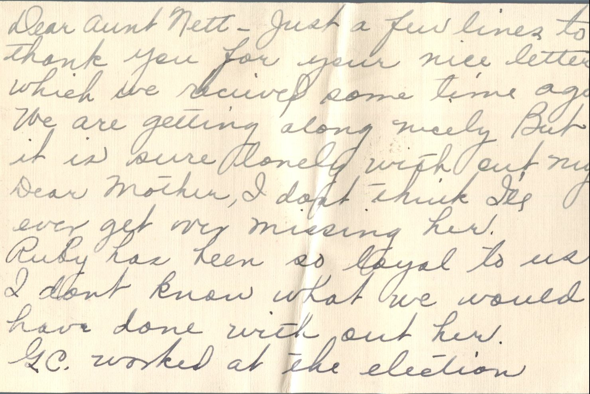
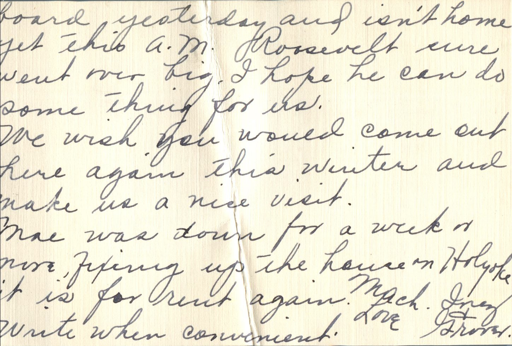
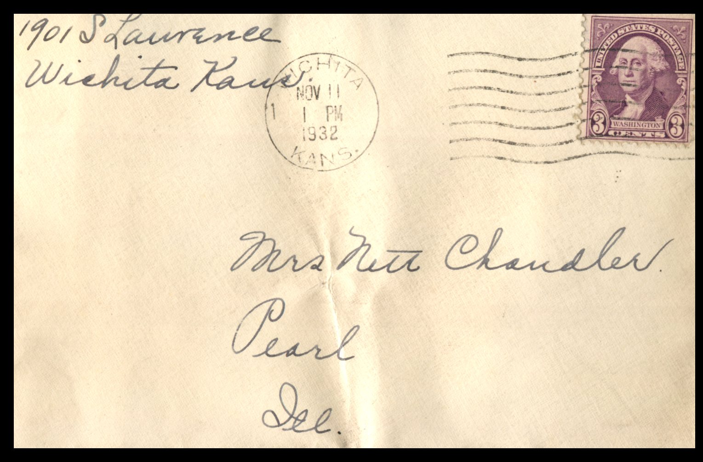

 

From: Inez and Grover, To: Jeanette Knox Chandler  
Mailed From: Wichita, Kansas on November 11, 1932

Mailing Address:  
Mrs. Nett Chandler  
Pearl, Illinois

Return Address:  
1901 S. Lawrence  
Wichita, Kansas

Dear Aunt Nett,  
Just a few lines to thank you for your nice letter which we recieved some time ago. We are getting along nicely but it is sure lonely without my dear Mother. I don’t think I’ll ever get over missing her. Ruby has been so loyal to use. I don’t know what we would have done without here. G.C. worked at the elections board yesterday and isn’t home yet this a.m. Roosevelt sure went over big. I hope he can do something for us.  
We wish you would come out here again this winter and make us a nice visit.  
Mae was down for a week or more, fixing up the house on Holyoke. It is for rent again. Write when convenient.  
Much Love,  
Inez and Grover