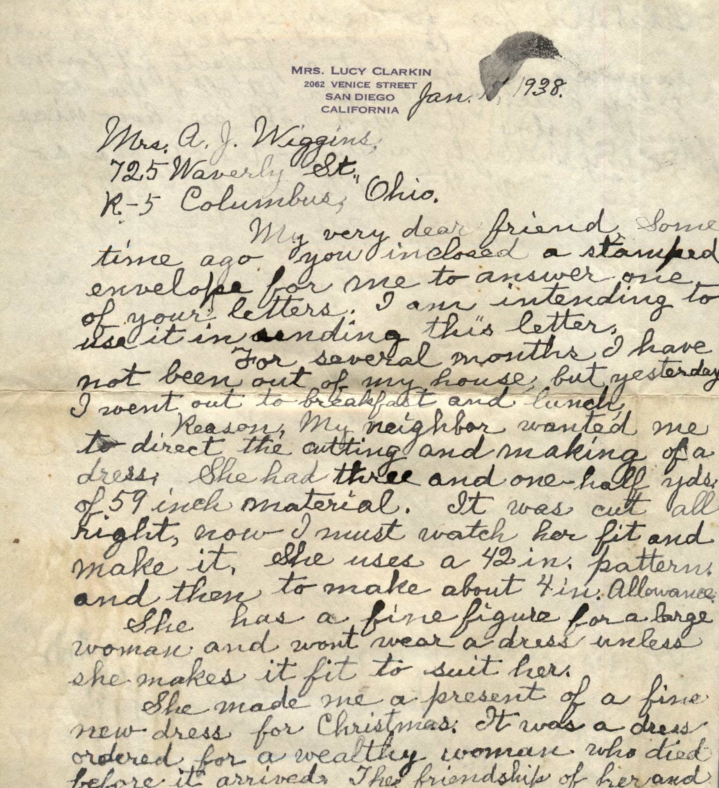
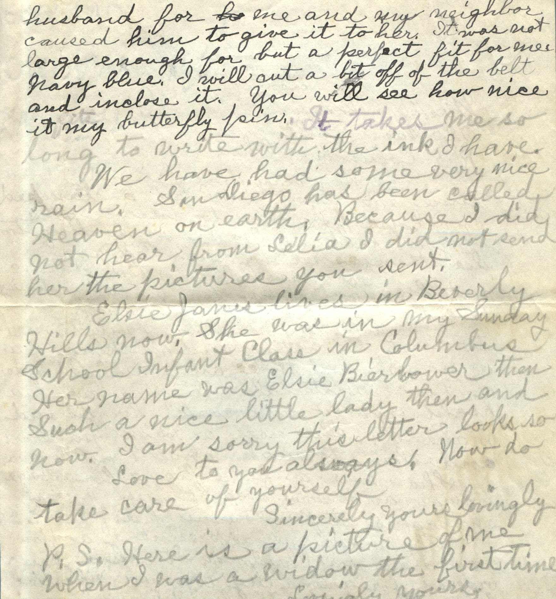

 

From: Lucy Clarkin, To: Amelia J. Wiggins  
Mailed from: San Diego, California on January 18, 1938

Mrs. Lucy Clarkin  
2062 Venice Street  
San Diego, California

Mrs. A. J. Wiggins  
725 Waverly St. R-5  
Columbus, Ohio

Jan. 18, 1938  
My very dear friend,  
Some time ago you enclosed a stamped envelope for me to answer one of your letters. I am intending to use it in sending this letter.  
For several months I have not been out of my house but yesterday I went out to breakfast and lunch.  
Reason: My neighbor wanted me to direct the cutting and make of a dress. She had three and one half yrs of 59 inch material. It was cut all right, now I must watch her fit and make it. She uses a 42 in pattern and then to make about 4 inch allowance.  
She has a fine figure for a large woman and wont wear a dress unless she makes it fit to suit her.  
She made me a present of a fine new dress for Christmas. It was a dress ordered for a wealthy woman who died before it arrived. The friendship of her and husband for me and my neighbor caused him to give it to her. It was not large enough for her but a perfect fit for me. Navy blue. I will cut a bit off of the belt and enclose it. You will see how nice it fits my butterfly pin. It takes me so long to write with the ink I have.  
We have had some very nice rain. San Diego has been called Heaven on earth. Because I did not hear from Celia I did not send her the pictures you sent.  
Elsie Janes lives in Beverly Hills now. She was in my Sunday School Infant Class in Columbus. Her name was Elsie Bierbower then. Such a nice little lady then and now. I am sorry this letter looks so.  
Love to you always. Now do take care of yourself.  
Sincerely yours lovingly,  
P.S. Here is a picture of me when I was a widow the first time.  
Lovingly yours.