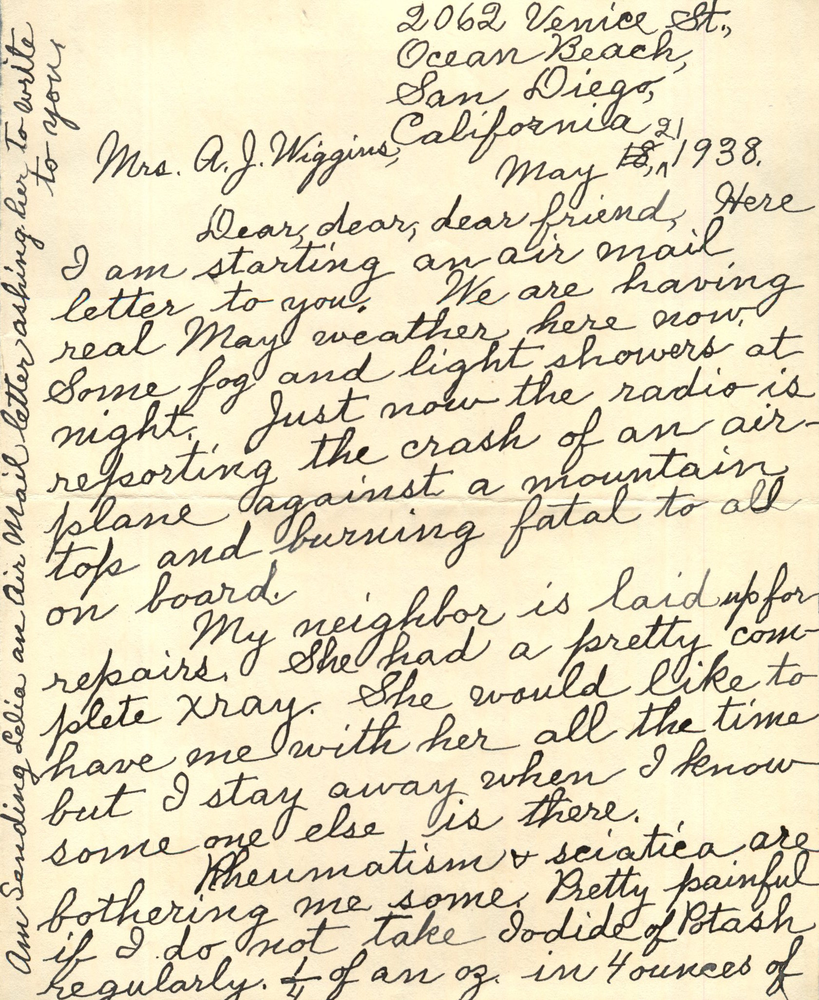
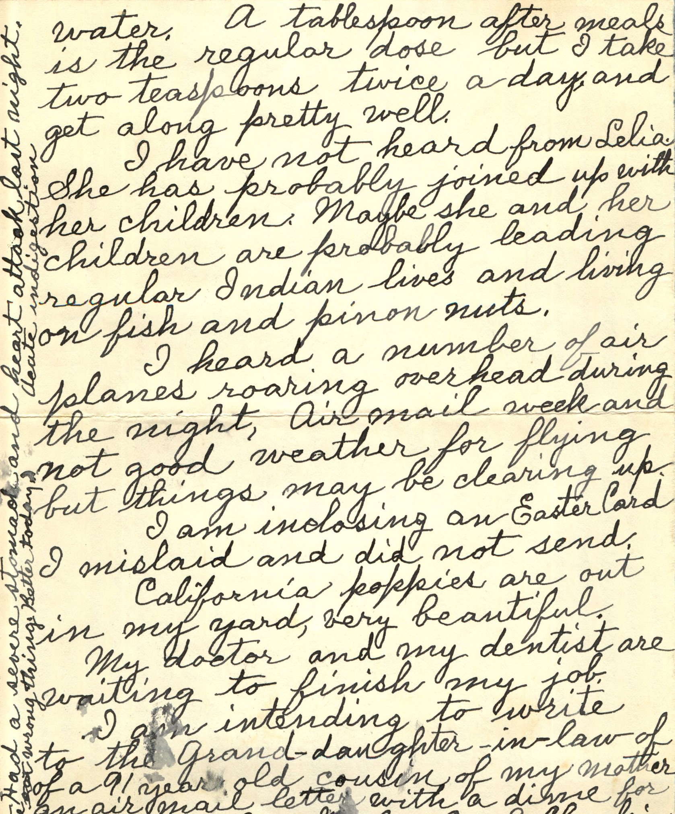
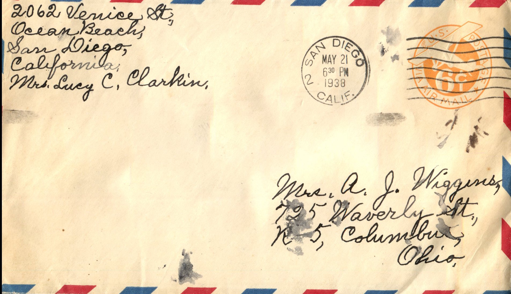

  

From: Lucy Clarkin, To: Amelia J. Wiggins  
Mailed From: San Diego on May 21, 1938

Mrs. Lucy C. Clarkin  
2062 Venice St.  
Ocean Beach  
San Diego, California

Mrs. A.J. Wiggins  
725 Waverly St. K-5  
Columbus, Ohio

Mrs. A.J. Wiggins  
May 21, 1938  
Dear, dear, dear, friend,  
Here I am starting an air mail letter to you. We are having real May weather here now. Some fog and light showers at night. Just now the radio is reporting the crash of an air plane against a mountain top and burning, fatal to all on board.  
My neighbor is laid up for repairs. She had a pretty complete Xray. She would like to have me with her all the time but I stay away when I know someone else is there.  
Rheumatism and sciatica are bothering me some. Pretty painful if I do not take Iodide of Potash regularly. 1/4 of an ounce in 4 ounce of water. A tablespoon after meals is the regular dose but I take 2 teaspoons twice a day and get along pretty well.  
I have not heard from Celia. She has probably joined up with her children. Maybe she and her children are probably leading regular Indian lives and living on fish and pinion nuts.  
I heard a number of air planes roaring overhead during the night. Air mail week and not good weather for flying but things may be clearing up.  
I am enclosing an Easter Card I mislaid and did not send.  
California poppies are out in my yard, very beautiful.  
My doctor and my dentist are waiting to finish my job.  
I am intending to write to the grand-daughter-in-law of a 91 year old cousin of my mother an air mail letter with a dime for the old man.  
Love &amp; much love,  
Lucy C. Clarkin  
Had a severe stomach and heart attack last night. Bad indigestion.  
Am sending Celia an Air Mail letter asking her to write to you.