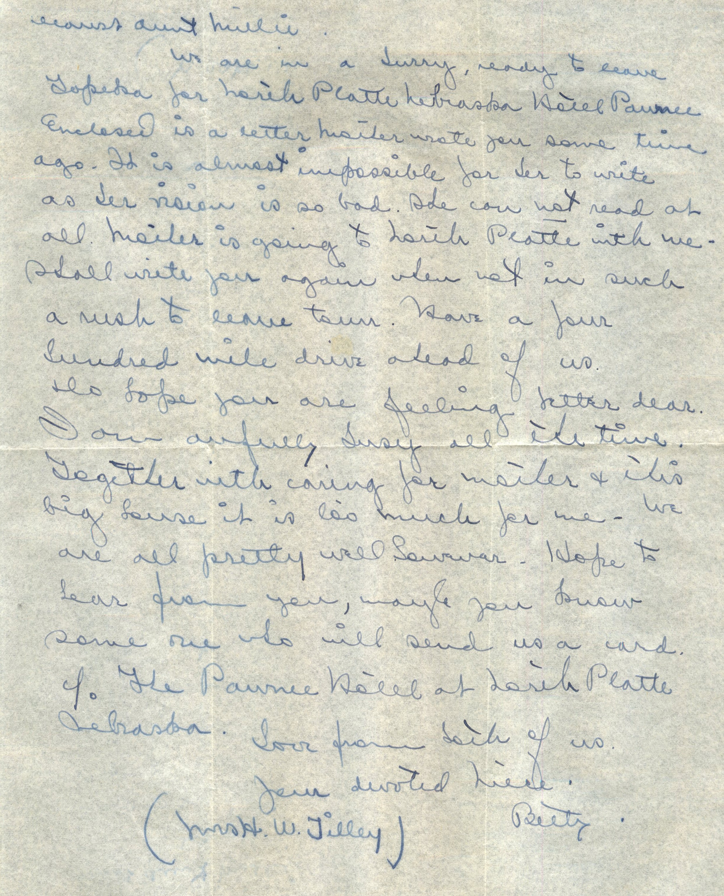
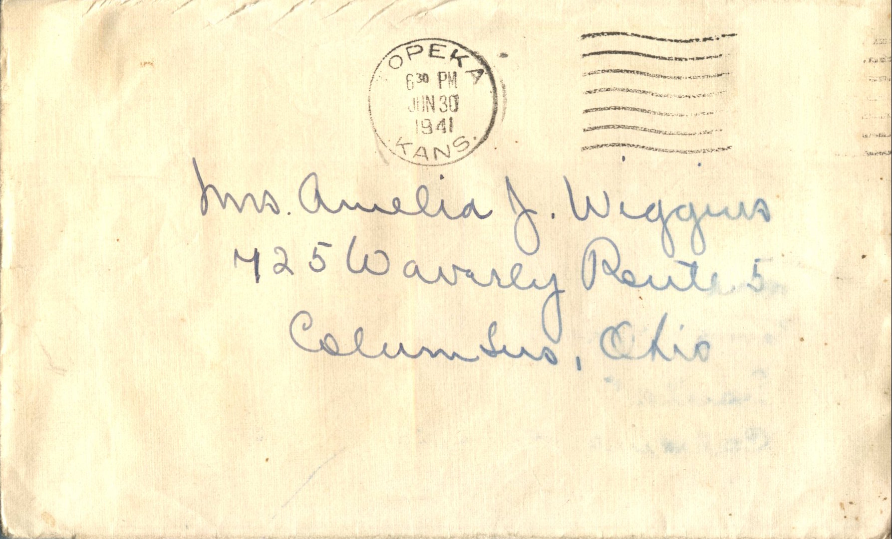
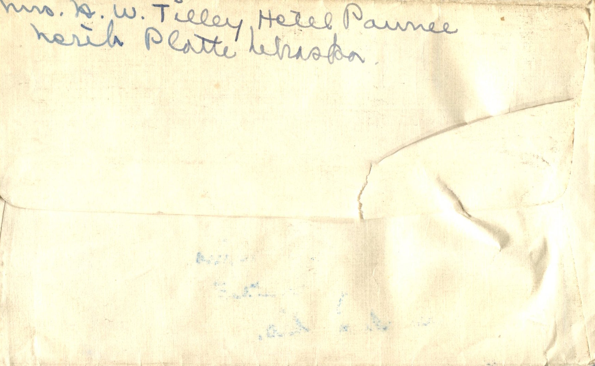

 

From: Betty Tilley, To: Amelia J. Wiggins  
Mailed From: Topeka, Kansas on June 30, 1941

Mrs. Amelia J. Wiggins  
725 Waverly Route 5  
Columbus, Ohio

Mrs. H.W. Tilley  
Hotel Paumee  
Merik Platte, Nebraska

Dearest Aunt Millie,  
We are in a hurry, ready to leave Topeka for Merik Platte Nebraska, Hotel Paumee. Enclosed is a letter Maifer wrote you some time ago. It is almost impossible for her to write as her vision is so bad. She can not read at all. Maifer is going to Merik Platte with me. Shall write you again when hot in such a rush to leave town. Have a four hundred mile drive ahead of us. We hope you are feeling better dear. I am awfully bust all the time. Together with caring for Maifer and this big house it is so much for me. We are all pretty well however. Hope to hear from you, maybe you know some one who will send us a card to The Paumee Htel at Merik Platte Nebraska.  
Love from both of us.  
Your devoted niece  
Betty  
(Mrs. H.W. Tilley)