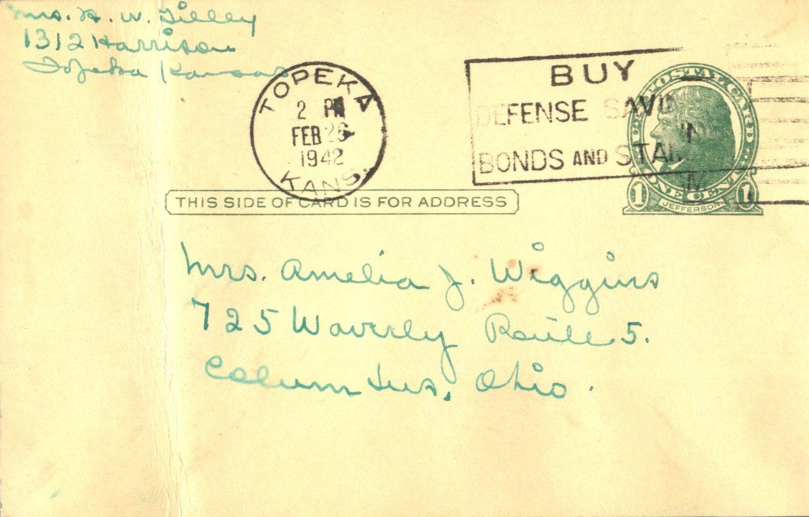
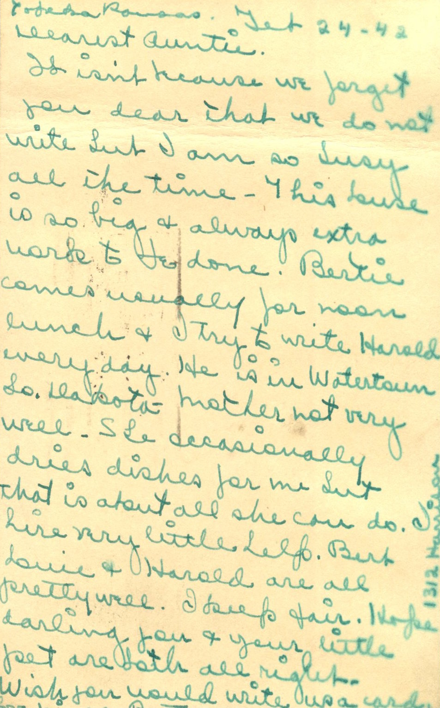

 

From: Betty Ann Tilley, To: Amelia J. Wiggins  
Mailed From: Topeka, Kansas on February 24, 1942

Mrs. B. A. Tilley  
1312 Harrison  
Topeka, Kansas

Mrs. Amelia J. Wiggins  
725 Waverly Route 5  
Columbus, Ohio

Tokepa, Kansas  
Feb. 24-42  
Dearest Auntie,  
It isn’t because we forgot you dear that we do not write but I am so busy all the time. This house is so big and always extra work to be done. Bertie comes usually of noon lunch and I try to write Harold every day. He is in Watertown, South Dakota. Mother not very well. She occasionally dries dishes for me but that is about all she can do. Hire very little help. Bert, Louie, and Harold are all pretty well. I keep fair. Hope darling you and your little pet are both all right. Wish you would write us a card.  
Love,  
Niece Betty  
1312 Harrison